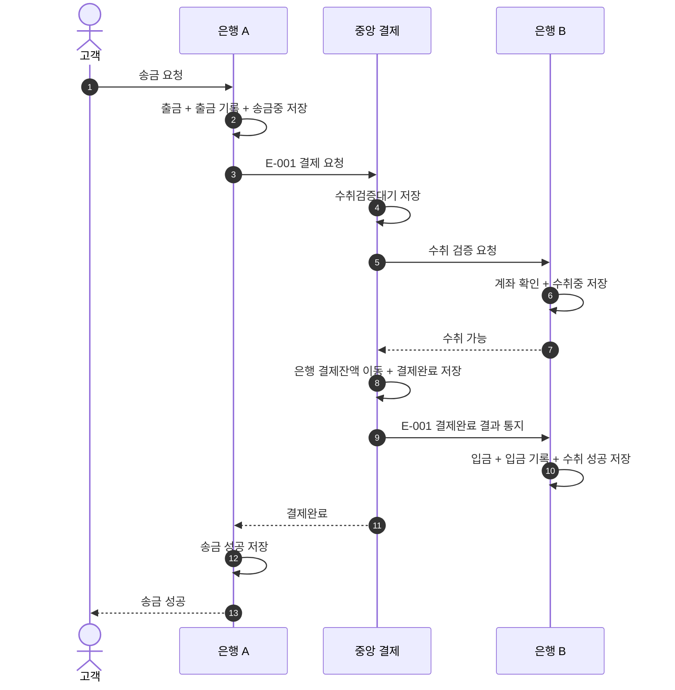

# Financial System Backend

Kotlin(Java 25), Spring Boot, JPA, Mysql, Flyway  
송금 시스템 백엔드 프로젝트 입니다. 여러 서비스에 걸친 송금 업무와 장애 발생 이후의 복구를 직접 설계하고 구현하는 것을 목표로 합니다.

### 주요 기능

- 회원 및 계좌관리: 회원가입, 로그인, 계좌 생성 및 조회
- 타행 은행 송금: 송금 계좌 출금 부터 은행 간 결제, 수취 계좌 입금 처리
- 송금 복구: Spring 스케줄러로 미완료 거래를 조회해 결제 결과에 따라 복구

### 정상 송금 시나리오

- 자세한 서비스별 시나리오는 [시나리오 문서](docs/scenarios)를 참고하세요.

## AI 사용

AI는 [기여 지침](docs/CONTRIBUTING.md)을 참고하며 다음과 같은 작업을 주로 담당합니다.

- 이슈 작성, 브랜치 및 PR 관리, 커밋 문구 작성
- 단순 반복 코딩, 의사결정 이력 문서 관리
