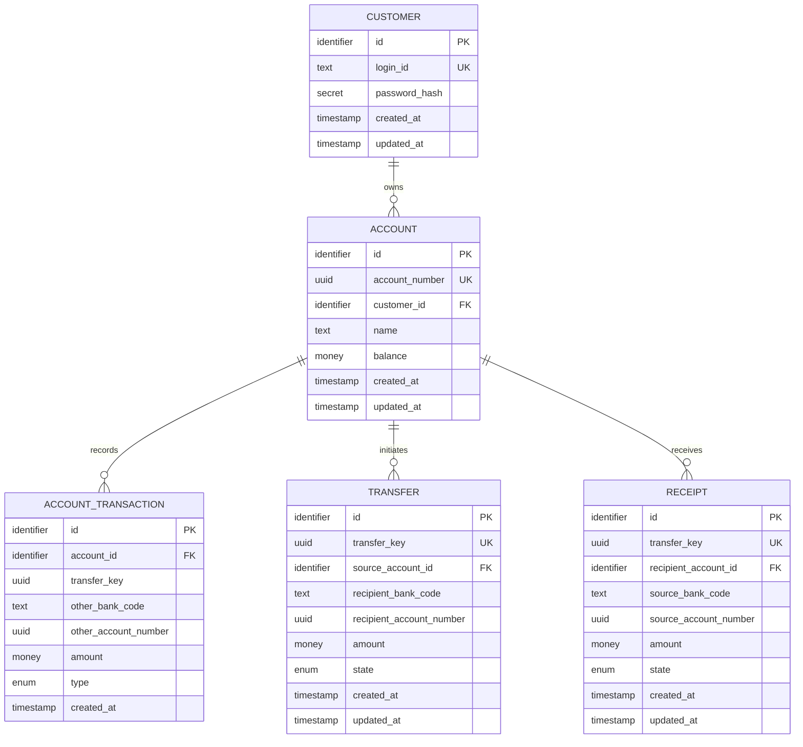
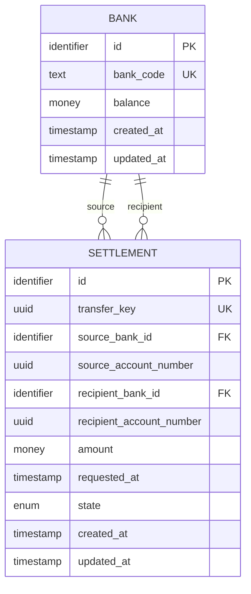
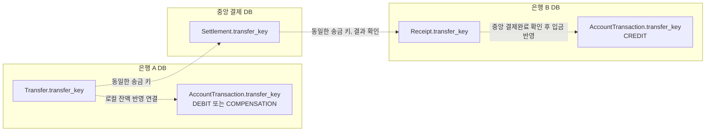

# ERD

은행 시스템과 중앙 결제 시스템은 DB를 공유하지 않는다. 아래 ERD의 자료형 표기는 물리 DB 자료형이 아니라 역할을 나타내는 개념 표기다.

## 은행 DB

동일한 스키마를 사용하는 은행 인스턴스가 각각 독립된 DB를 가진다.

### 은행 DB 제약

- `CUSTOMER.login_id`와 `ACCOUNT.account_number`는 각각 은행 DB 안에서 고유하다.
- `ACCOUNT_TRANSACTION`의 `(transfer_key, type)` 조합은 고유하다.
- `ACCOUNT_TRANSACTION.type`은 `DEBIT`, `CREDIT`, `COMPENSATION` 중 하나다.
- `DEBIT.amount`는 음수이고 `CREDIT.amount`와 `COMPENSATION.amount`는 양수다.
- `TRANSFER.state`는 `송금중`, `성공`, `실패` 중 하나다.
- `RECEIPT.transfer_key`는 은행 DB 안에서 고유하며 `recipient_account_id`는 수취 계좌를 참조한다.
- `RECEIPT.state`는 `RECEIVING`(수취대기), `SUCCEEDED`(성공), `FAILED`(실패) 중 하나다.
- 은행 간 수취의 잔액 증가, `CREDIT` 기록 생성, `RECEIPT` 성공 변경은 하나의 로컬 DB 트랜잭션으로 처리한다.
- `TRANSFER.transfer_key`와 `ACCOUNT_TRANSACTION.transfer_key`는 FK로 강제하지 않는다. 수취 은행의 입금 기록과 시연용 내부 이체 기록처럼 같은 은행 DB에 대응하는 `TRANSFER` 행이 없는 경우도 있기 때문이다.

## 중앙 결제 DB

### 중앙 결제 DB 제약

- `BANK.bank_code`와 `SETTLEMENT.transfer_key`는 각각 중앙 결제 DB 안에서 고유하다.
- `SETTLEMENT.source_bank_id`와 `recipient_bank_id`는 서로 달라야 한다.
- `SETTLEMENT.amount`는 0보다 큰 정수다.
- `SETTLEMENT.requested_at`은 송금 은행이 정한 최초 결제 요청 시각이며 같은 결제의 재전송에서 변경하지 않는다.
- `SETTLEMENT.state`는 `RECIPIENT_VALIDATION_PENDING`, `SETTLED`, `REJECTED` 중 하나다.
- `SETTLED` 전이와 양쪽 `BANK.balance` 변경은 하나의 중앙 DB 트랜잭션으로 처리한다.

## 시스템 간 논리 연결

`transfer_key`는 독립 DB 사이에서 같은 자금 이동을 추적하는 논리 키이며, DB 간 FK는 만들지 않는다.

## 관계 검증 결과

- 고객 한 명은 여러 계좌를 가질 수 있고 모든 계좌는 정확히 한 고객에게 속한다.
- 계좌 한 개에는 여러 계좌 거래 기록과 여러 송금이 연결될 수 있다.
- 계좌 한 개에는 여러 수취 기록이 연결될 수 있다. 시연용 내부 이체에는 수취 기록을 만들지 않는다.
- 중앙 결제 거래는 송금 은행과 수취 은행을 각각 하나의 `BANK` 행으로 참조한다.
- 고객 계좌는 은행 DB에만 존재하며 중앙 결제 DB는 계좌번호를 참조 정보로만 저장한다.
- 은행별 결제잔액은 별도 결제계좌 테이블 없이 `BANK.balance`에 저장한다.
