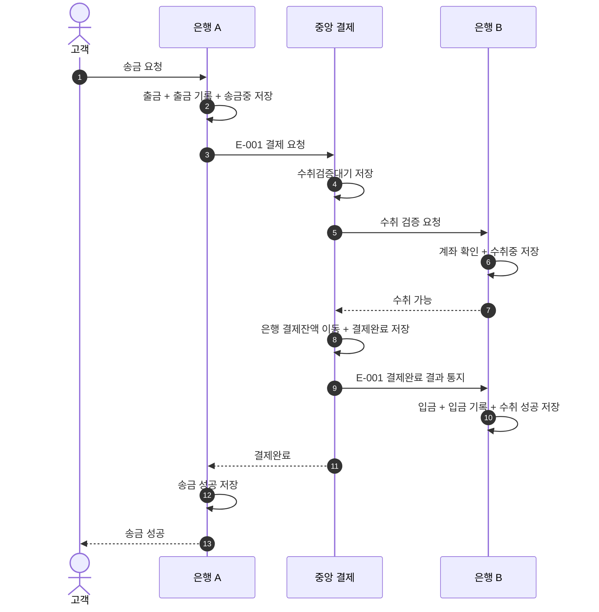

# S-001 — 정상 은행 간 송금 성공

상태: 확정

## 목적

고객의 송금 요청이 출금, 중앙 결제, 수취 입금을 거쳐 성공 응답으로 끝나는 흐름을 확인한다.

## 사전 조건

- 고객 A는 은행 A의 `A-001`을 소유하며 잔액은 100,000원이다.
- 은행 B에 `B-001`이 존재하며 잔액은 100,000원이다.
- 두 은행의 중앙 결제잔액은 각각 1,000,000원이다.
- 송금액은 10,000원이다. 은행 A가 발급할 송금 키는 `E-001`이며, 세 시스템에 같은 키의 기록은 없다.
- 모든 요청과 응답은 정상적으로 전달되며 결제 만료 전에 결제가 완료된다.

## 사건 순서

1. 고객 A가 `A-001`에서 은행 B의 `B-001`로 송금을 요청한다.
2. 은행 A가 송금액, 계좌 소유권, 잔액을 검증한다.
3. 은행 A가 하나의 로컬 DB 트랜잭션에서 잔액을 10,000원 차감하고 출금 기록과 `송금중` 송금을 저장한다.
4. 저장을 완료한 은행 A가 송금 생성 시각을 `transferCreatedAt`으로 전달하며 중앙 결제 시스템에 `E-001` 결제를 요청한다.
5. 중앙 결제 시스템이 `수취검증대기` 결제를 저장하고 은행 B에 수취 검증을 요청한다.
6. 은행 B가 `B-001`의 존재를 확인한다. 송금 생성 시각을 포함한 `수취중` 수취 기록을 저장한 다음 수취 가능을 응답한다. 이때 고객 잔액은 변경하지 않는다.
7. 중앙 결제 시스템이 하나의 DB 트랜잭션에서 은행 A의 결제잔액을 차감하고 은행 B의 결제잔액을 증가시키며 결제를 `결제완료`로 변경한다.
8. 저장을 완료한 중앙 결제 시스템이 은행 B에 `결제완료` 결과를 통지한다.
9. 은행 B가 하나의 로컬 DB 트랜잭션에서 고객 잔액 증가, 입금 기록 생성, 수취 상태의 `성공` 변경을 저장한다.
10. 중앙 결제 시스템이 은행 A에 `결제완료`를 응답한다. 은행 A는 송금을 `성공`으로 저장하고 고객에게 성공을 응답한다.

## 사건 흐름

## 기대 결과

- 은행 A: `A-001` 잔액 90,000원, 출금 기록 한 건, 송금 `성공`. 보상 기록은 없다.
- 중앙 결제: `결제완료`. 은행 A 결제잔액 990,000원, 은행 B 결제잔액 1,010,000원.
- 은행 B: `B-001` 잔액 110,000원, 입금 기록 한 건, 수취 `성공`.
- 세 시스템의 기록은 송금 키 `E-001`로 연결된다.

## 금지되는 결과

- 같은 거래로 출금, 중앙 결제잔액 이동, 입금이 두 번 반영된다.
- 중앙 결제완료 전에 송금을 성공으로 확정하거나 수취 고객에게 입금한다.
- 잔액 변경과 대응하는 거래 기록 중 일부만 저장된다.
- 중앙 결제완료 거래에 보상이 발생한다.
