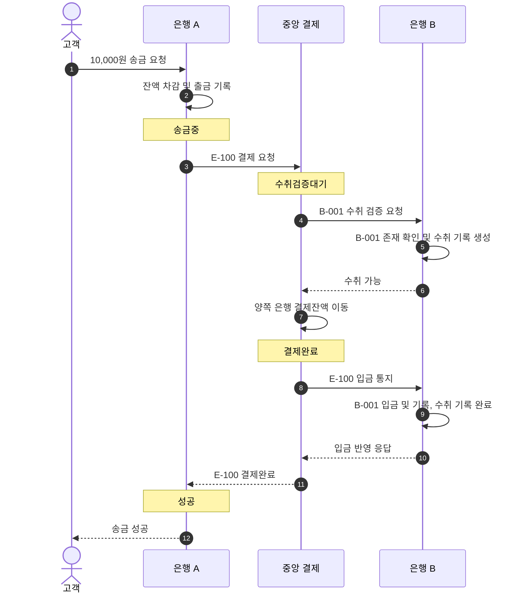

# S-001 — 정상 은행 간 송금 성공

상태: 확정

## 목적

고객 요청부터 송금 은행 출금, 중앙 결제와 수취 은행 입금까지 한 요청 사슬로 끝나는 기준 흐름을 확인한다.

## 사전 조건

- 고객 A는 은행 A의 계좌 `A-001`을 소유한다.
- `A-001` 잔액은 100,000원이다.
- 은행 B에 수취 계좌 `B-001`이 존재하고 잔액은 100,000원이다.
- 송금액은 10,000원이고 외부 거래 ID는 `E-100`이다.
- 중앙 결제잔액은 은행 A와 은행 B가 각각 1,000,000원이다.
- 세 시스템에 `E-100` 거래 기록은 없다.

## 발생한 사건

1. 고객 A가 `A-001`에서 은행 B의 `B-001`로 10,000원 송금을 요청한다.
2. 은행 A가 금액, 고객 소유권과 잔액을 검증한다.
3. 은행 A가 한 로컬 DB 트랜잭션에서 `A-001`을 10,000원 차감하고 출금 기록을 생성한다. 로컬 송금은 `송금중`으로 기록된다.
4. 은행 A가 중앙 결제 시스템에 `E-100` 결제를 요청하고, 중앙 결제 시스템이 `E-100`을 `수취검증대기`로 생성한다.
5. 중앙 결제 시스템이 은행 B에 `B-001`의 수취 검증을 요청한다. 은행 B는 `B-001`의 존재를 확인하고 `E-100` 수취 기록을 만든 뒤 수취 가능을 응답한다.
6. 중앙 결제 시스템이 한 DB 트랜잭션에서 은행 A 결제잔액을 10,000원 차감하고 은행 B 결제잔액을 10,000원 증가시키며 `E-100`을 `결제완료`로 변경한다.
7. 중앙 결제 시스템이 은행 B에 `E-100` 입금을 통지한다. 은행 B는 한 로컬 DB 트랜잭션에서 `B-001`에 10,000원을 더하고 입금 기록을 생성하며 수취 기록을 완료한다.
8. 중앙 결제 시스템이 은행 A의 결제 요청에 `결제완료`를 응답한다. 은행 A는 로컬 송금을 `성공`으로 변경한다.

## 사건 흐름 다이어그램

## 확인되는 사실

### 송금 은행

- `A-001` 잔액은 90,000원이다.
- `E-100` 출금 기록이 한 건 존재하고 로컬 송금 상태는 `성공`이다.
- 보상 기록은 없다.

### 중앙 결제 시스템

- `E-100` 상태는 `결제완료`다.
- 은행 A 결제잔액은 990,000원이고 은행 B 결제잔액은 1,010,000원이다.

### 수취 은행

- `B-001` 잔액은 110,000원이다.
- `E-100`을 근거로 한 입금 기록이 한 건 존재하고 수취 기록은 완료 상태다.

## 최종 기대 결과

- 고객 A는 송금 요청의 응답으로 성공을 확인하고, 계좌 내역에서 10,000원 출금 기록과 성공한 송금을 확인한다.
- 수취 고객은 계좌 내역에서 10,000원 입금 기록을 확인한다.
- 세 시스템의 기록은 외부 거래 ID `E-100`으로 연결된다.

## 금지되는 결과

- 어느 계좌나 은행 결제계좌에도 같은 거래가 두 번 반영되어서는 안 된다.
- 중앙 결제가 완료되기 전에 은행 A가 송금을 `성공`으로 확정해서는 안 된다.
- 수취 검증 응답만으로 은행 B가 `B-001`에 입금해서는 안 된다.
- 중앙 결제 완료 거래에 보상 기록이 존재해서는 안 된다.

## 적용되는 불변식

- 하나의 송금은 송금 계좌에서 한 번만 출금되고 수취 계좌에 한 번만 입금된다.
- 중앙 결제 전후 두 은행 결제잔액 합계는 2,000,000원으로 보존된다.
- 잔액 변경과 대응하는 계좌 거래 기록은 같은 로컬 DB 트랜잭션에서 처리된다.
- 수취 가능 확인만으로 수취 고객 계좌 잔액을 증가시켜서는 안 된다.
