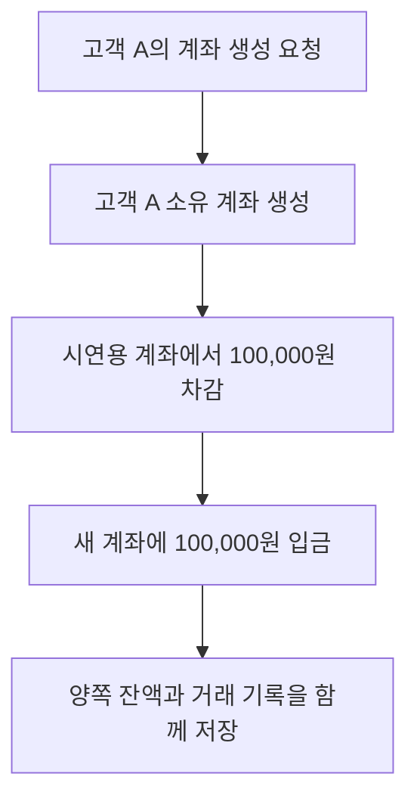

# S-002 — 계좌 생성과 은행 내부 자금 이체

상태: 확정

## 목적

계좌 생성 시 시연용 고객 계좌에서 100,000원을 이체하고, 양쪽 잔액 변경을 거래 기록으로 남기는 흐름을 확인한다.

## 사전 조건

- 고객 A는 가입하고 로그인한 상태이며, 생성할 계좌는 아직 없다.
- 같은 은행에 시연용 고객 B와 고객 B의 계좌가 초기 데이터로 존재한다.
- 시연용 계좌의 잔액은 1,000,000원이다. 별도의 계좌 유형은 사용하지 않는다.
- 내부 이체에 사용할 송금 키는 `I-002`이며 같은 키의 거래 기록은 없다.

## 사건 순서

1. 고객 A가 계좌 생성을 요청한다.
2. 은행이 고객 A 소유의 새 계좌를 생성한다.
3. 은행이 시연용 계좌에서 100,000원을 차감하고 새 계좌에 같은 금액을 입금한다. 양쪽 잔액 변경과 거래 기록은 하나의 로컬 DB 트랜잭션에서 저장한다.
4. 시연용 계좌에는 `I-002`, `DEBIT`, -100,000원을 기록한다. 새 계좌에는 `I-002`, `CREDIT`, +100,000원을 기록한다.

## 사건 흐름

## 기대 결과

- 시연용 계좌: 잔액 900,000원, `DEBIT` 기록 한 건.
- 새 계좌: 잔액 100,000원, `CREDIT` 기록 한 건. 고객 A가 계좌와 입금 내역을 조회할 수 있다.
- 두 계좌의 거래 기록은 `I-002`로 연결되며 잔액 합계는 1,000,000원으로 유지된다.
- 중앙 결제 거래와 은행 결제잔액 변경은 발생하지 않는다.

## 금지되는 결과

- 시연용 계좌의 출금 없이 새 계좌의 잔액만 100,000원으로 설정한다.
- 한쪽 잔액이나 거래 기록만 저장한다.
- 입금 기록을 별도의 `초기 자금` 유형으로 남긴다.
- 다른 고객이 새 계좌를 자신의 계좌로 조회하거나 거래한다.
