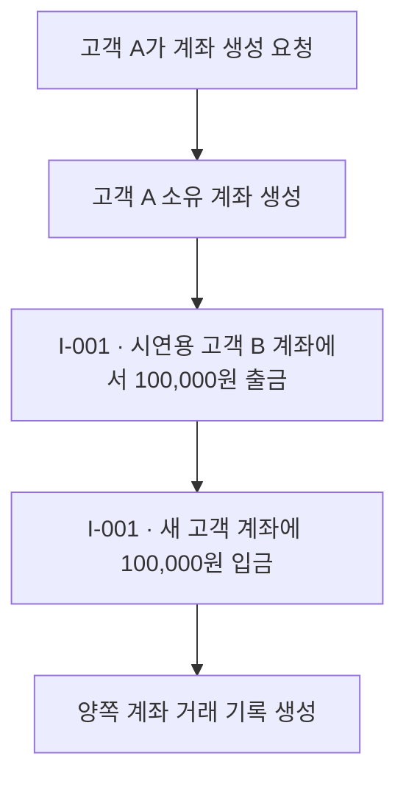

# S-002 — 계좌 생성과 은행 내부 자금 이체

상태: 확정

## 목적

계좌 생성 시 시연용 고객 계좌에서 새 고객 계좌로 100,000원이 이체되고, 양쪽 계좌의 잔액 변동이 거래 기록으로 남는지 확인한다.

## 사전 조건

- 고객 A는 가입하고 로그인한 상태다.
- 고객 A에게 새로 생성할 계좌는 아직 존재하지 않는다.
- 시연용 고객 B와 고객 B가 소유한 시연용 계좌가 초기 데이터로 존재한다.
- 시연용 계좌의 잔액은 1,000,000원이다.
- 내부 이체에 사용할 송금 키는 `I-001`이며 두 계좌에 해당 키의 거래 기록은 없다.

## 발생한 사건

1. 고객 A가 계좌 생성을 요청한다.
2. 은행이 고객 A 소유의 새 계좌를 생성한다.
3. 송금 키 `I-001`을 사용해 시연용 고객 B의 계좌에서 새 고객 계좌로 100,000원을 이체한다.
4. 시연용 계좌에 `I-001`, `DEBIT`, -100,000원 기록을 남기고 새 고객 계좌에 `I-001`, `CREDIT`, +100,000원 기록을 남긴다.

## 사건 흐름 다이어그램

## 확인되는 사실

### 은행

- 새 계좌는 고객 A가 소유한다.
- 시연용 계좌는 고객 B가 소유하며 별도 계좌 유형을 갖지 않는다.
- 시연용 계좌의 잔액은 900,000원이고 `I-001`, `DEBIT`, -100,000원 기록이 한 건 존재한다.
- 새 고객 계좌의 잔액은 100,000원이고 `I-001`, `CREDIT`, +100,000원 기록이 한 건 존재한다.
- `초기 자금`이라는 계좌 거래 기록은 존재하지 않는다.

### 중앙 결제 시스템

- 계좌 생성과 은행 내부 이체로 중앙 결제 거래나 은행 결제잔액 변경이 발생하지 않는다.

## 최종 기대 결과

- 고객 A는 새 계좌와 현재 잔액 100,000원을 조회할 수 있다.
- 고객 A는 계좌 내역에서 은행 내부 이체로 들어온 +100,000원 입금 기록을 확인할 수 있다.

## 금지되는 결과

- 새 고객 계좌의 잔액만 100,000원으로 직접 설정해서는 안 된다.
- 시연용 계좌의 출금 없이 새 고객 계좌에만 입금해서는 안 된다.
- 양쪽 계좌 중 한쪽의 잔액만 변경되거나 한쪽의 거래 기록만 생성되어서는 안 된다.
- 다른 고객이 새 계좌를 자기 계좌로 조회하거나 거래해서는 안 된다.

## 적용되는 불변식

- 모든 계좌는 정확히 한 고객에게 소유되며 고객 식별자가 반드시 존재한다.
- 은행 내부 이체 전후 두 계좌 잔액의 합계는 보존된다.
- 각 계좌의 잔액 변동은 부호 있는 계좌 거래 기록으로 설명된다.
- 내부 이체의 출금과 입금 기록은 같은 `transfer_key`로 연결된다.
