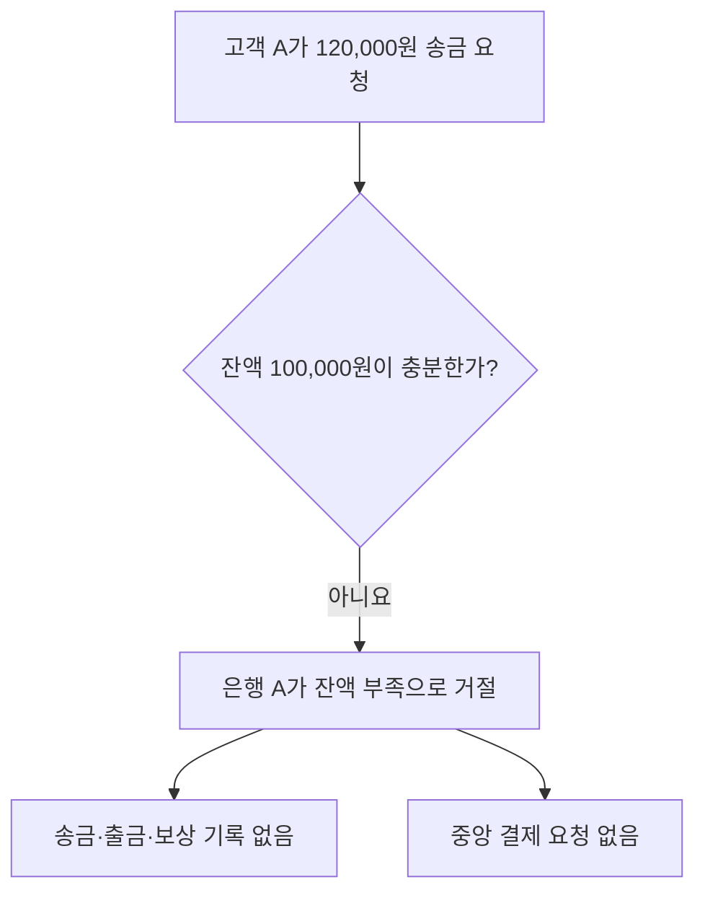

# S-004 — 고객 잔액 부족

상태: 확정

## 목적

고객 계좌 잔액을 초과한 송금 요청이 출금 전에 거절되는지 확인한다.

## 사전 조건

- 고객 A는 은행 A의 계좌 `A-001`을 소유한다.
- `A-001` 잔액은 100,000원이다.
- 은행 B에 수취 계좌 `B-001`이 존재한다.
- 송금액은 120,000원이고 외부 거래 ID는 `E-102`다.

## 발생한 사건

1. 고객 A가 `A-001`에서 `B-001`로 120,000원 송금을 요청한다.
2. 은행 A가 송금 시작 전 잔액 검증에서 요청을 거절한다.

## 사건 흐름 다이어그램

## 확인되는 사실

### 송금 은행

- `A-001` 잔액은 100,000원으로 유지된다.
- `E-102` 송금 거래, 출금 기록과 보상 기록은 생성되지 않는다.

### 중앙 결제 시스템

- `E-102` 중앙 결제 거래는 생성되지 않고 은행 결제잔액도 변하지 않는다.

### 수취 은행

- `B-001` 잔액과 거래 기록은 변하지 않는다.

## 최종 기대 결과

- 고객은 잔액 부족으로 요청이 거절됐음을 확인한다.
- 이 요청은 `실패` 송금이나 계좌 거래 내역으로 표시되지 않는다.

## 금지되는 결과

- 고객 계좌 잔액이 음수가 되어서는 안 된다.
- 일부 금액만 출금하거나 출금 후 보상하는 방식으로 사전 거절을 처리해서는 안 된다.

## 적용되는 불변식

- 송금으로 고객 계좌 잔액이 0보다 작아져서는 안 된다.
- 사전 검증에 실패한 요청은 송금 거래와 계좌 거래 기록을 생성하지 않는다.
