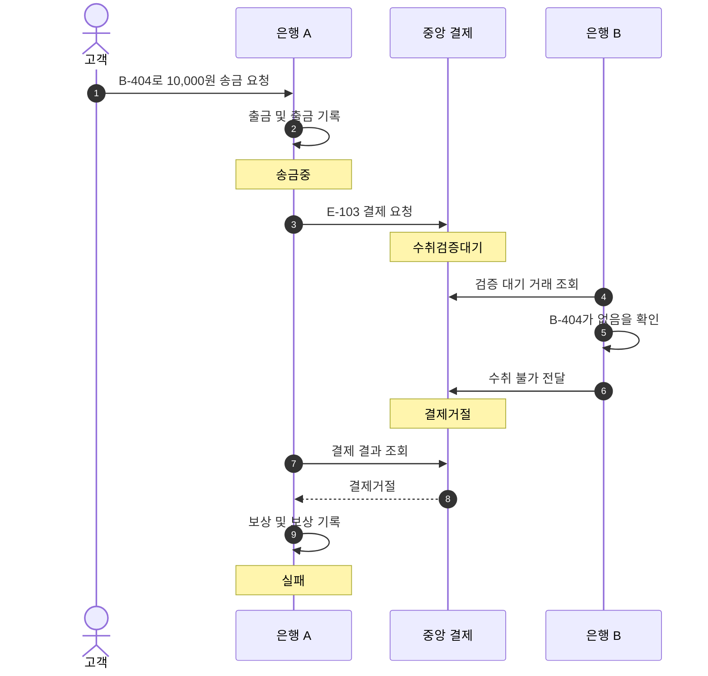

# S-005 — 수취 계좌 없음

상태: 확정

## 목적

수취 은행이 계좌 부재를 확정하면 중앙 결제가 거절되고 송금 은행이 출금을 보상하는지 확인한다.

## 사전 조건

- 고객 A는 은행 A의 계좌 `A-001`을 소유하고 잔액은 100,000원이다.
- 은행 B에 수취 계좌 `B-404`는 존재하지 않는다.
- 송금액은 10,000원이고 외부 거래 ID는 `E-103`이다.
- 중앙 결제잔액은 은행 A와 은행 B가 각각 1,000,000원이다.

## 발생한 사건

1. 은행 A가 요청을 검증하고 한 로컬 DB 트랜잭션에서 `A-001`을 10,000원 차감하며 출금 기록을 생성한다. 로컬 송금은 `송금중`으로 기록된다.
2. 중앙 결제 시스템이 `E-103`을 `수취검증대기`로 생성한다.
3. 은행 B가 검증 대기 거래를 조회하고 `B-404`가 존재하지 않는다는 수취 불가 결과를 전달한다.
4. 중앙 결제 시스템이 `E-103`을 `결제거절`로 확정한다.
5. 은행 A가 거절 결과를 조회하고 한 로컬 DB 트랜잭션에서 10,000원 보상 기록과 잔액 반환을 처리한다. 보상 완료를 근거로 로컬 송금을 `실패`로 변경한다.

## 사건 흐름 다이어그램

## 확인되는 사실

### 송금 은행

- `A-001`에는 10,000원 출금 기록과 10,000원 보상 기록이 각각 한 건 존재한다.
- 최종 잔액은 100,000원이고 송금 상태는 `실패`다.

### 중앙 결제 시스템

- `E-103` 상태는 `결제거절`이다.
- 두 은행 결제잔액은 각각 1,000,000원으로 변하지 않는다.

### 수취 은행

- `E-103`을 근거로 한 고객 입금 기록은 없다.

## 최종 기대 결과

- 고객 A는 송금 실패와 출금액이 반환된 사실을 확인할 수 있다.
- 중앙 결제거절과 은행 A의 실패 기록은 `E-103`으로 연결된다.

## 금지되는 결과

- 존재하지 않는 계좌에 중앙 결제를 완료하거나 고객 입금을 기록해서는 안 된다.
- 보상 후에도 송금 상태가 `송금중`으로 남거나 동일 출금을 두 번 보상해서는 안 된다.

## 적용되는 불변식

- 수취 가능 확인이 없는 거래는 중앙 결제완료가 될 수 없다.
- 중앙 결제거절에서 은행 결제잔액과 수취 고객 잔액은 변하지 않는다.
- 실패 송금에는 원래 출금과 한 번의 보상 기록이 존재한다.
