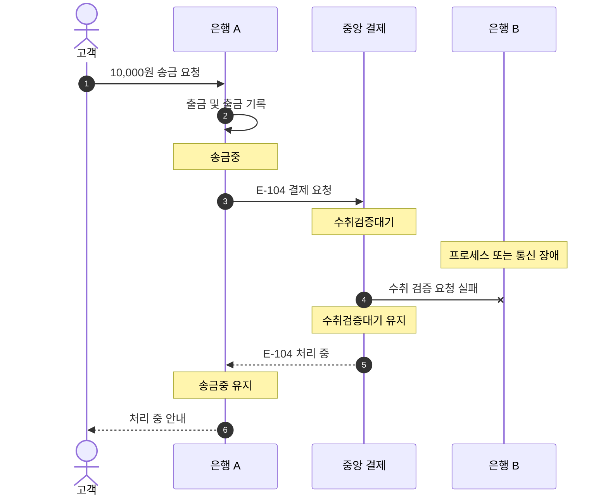

# S-006 — 수취 은행 검증 지연

상태: 확정

## 목적

수취 은행의 장애로 중앙이 검증 응답을 받지 못할 때 중앙 거래가 거절로 추측되지 않고 대기하며, 송금 은행이 결과 불명을 실패로 확정하지 않는지 확인한다.

## 사전 조건

- 고객 A의 은행 A 계좌 `A-001` 잔액은 100,000원이다.
- 은행 B에 수취 계좌 `B-001`이 존재하고 잔액은 100,000원이다.
- 송금액은 10,000원이고 외부 거래 ID는 `E-104`다.
- 중앙 결제잔액은 은행 A와 은행 B가 각각 1,000,000원이다.

## 발생한 사건

1. 은행 A가 `A-001`에서 10,000원을 출금하고 출금 기록과 `송금중` 거래를 생성한다.
2. 은행 A가 중앙 결제 시스템에 `E-104` 결제를 요청하고, 중앙 결제 시스템이 `E-104`를 `수취검증대기`로 생성한다.
3. 중앙 결제 시스템이 은행 B에 수취 검증을 요청하지만 은행 B의 프로세스 또는 통신 장애로 응답을 받지 못한다.
4. 중앙 결제 시스템이 `E-104`를 `수취검증대기`로 유지한 채 은행 A의 결제 요청에 처리 중임을 응답한다. 은행 A는 `송금중`을 유지한다.

## 사건 흐름 다이어그램

## 장애 직후 확인되는 사실

### 송금 은행

- `A-001` 잔액은 90,000원이고 출금 기록은 한 건이다.
- 로컬 송금 상태는 `송금중`이며 보상 기록은 없다.

### 중앙 결제 시스템

- `E-104` 상태는 `수취검증대기`다.
- 두 은행 결제잔액은 각각 1,000,000원으로 변하지 않는다.

### 수취 은행

- `B-001` 잔액은 100,000원이며 입금 기록과 수취 기록은 없다.
- 수취 가능 또는 불가 응답이 아직 중앙에 전달되지 않았다.

## 최종 기대 결과

- 장애가 계속되는 동안 `E-104`는 `수취검증대기`, 은행 A의 송금은 `송금중`을 유지한다.
- 은행 B가 복구한 뒤 중앙 결제 시스템이 같은 `E-104`의 수취 검증을 다시 요청하면, 은행 B의 계좌 존재 확인을 근거로 중앙 결제와 양쪽 은행의 로컬 반영을 계속할 수 있다.
- 은행 A는 `송금중` 송금의 결과를 중앙에 확인 조회하여 결제가 확정된 뒤 `성공`으로 수렴한다.

## 금지되는 결과

- 응답이 없다는 이유만으로 `결제거절`이나 송금 `실패`를 확정해서는 안 된다.
- 결과 불명 상태에서 은행 A가 출금을 보상하거나 은행 B가 입금해서는 안 된다.
- 재요청된 수취 검증으로 같은 `E-104`의 수취 기록이 두 건 생기거나 중앙 결제가 두 번 실행되어서는 안 된다.

## 적용되는 불변식

- 수취 은행의 수취 가능 확인 없이 중앙 결제를 완료해서는 안 된다.
- 확인할 수 없는 결과를 추측하여 실패 처리하거나 보상해서는 안 된다.
- 같은 검증 요청을 여러 번 받아도 중앙 결제는 한 번만 실행되어야 한다.
