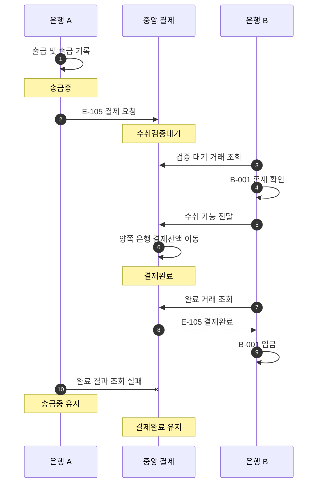

# S-007 — 결제완료 후 송금 상태 반영 지연

상태: 확정

## 목적

중앙 결제는 완료됐지만 송금 은행이 아직 결과를 반영하지 못한 중간 상태와 최종 수렴 결과를 확인한다.

## 사전 조건

- 고객 A의 은행 A 계좌 `A-001` 최초 잔액은 100,000원이다.
- 은행 B의 수취 계좌 `B-001` 최초 잔액은 100,000원이다.
- 송금액은 10,000원이고 외부 거래 ID는 `E-105`다.
- 중앙 결제잔액은 최초에 은행 A와 은행 B가 각각 1,000,000원이다.

## 발생한 사건

1. 은행 A가 `A-001`에서 10,000원을 출금하고 출금 기록과 `송금중` 거래를 생성한다.
2. 은행 A가 중앙 결제 시스템에 `E-105` 결제를 요청한다.
3. 중앙 결제 시스템이 `E-105`를 `수취검증대기`로 생성한다.
4. 은행 B가 검증 대기 거래를 조회하고 `B-001`의 존재를 확인하여 수취 가능 결과를 전달한다.
5. 중앙 결제 시스템이 두 은행 결제잔액을 이동하고 `E-105`를 `결제완료`로 확정한다.
6. 은행 B는 완료 거래를 조회하여 `B-001`에 입금한다.
7. 은행 A는 프로세스 또는 통신 장애로 아직 중앙 완료 결과를 조회하지 못한다.

## 사건 흐름 다이어그램

## 장애 직후 확인되는 사실

### 송금 은행

- `A-001` 잔액은 90,000원이고 출금 기록은 한 건이다.
- 로컬 송금 상태는 아직 `송금중`이며 보상 기록은 없다.

### 중앙 결제 시스템

- `E-105` 상태는 `결제완료`다.
- 은행 A 결제잔액은 990,000원이고 은행 B 결제잔액은 1,010,000원이다.

### 수취 은행

- `B-001` 잔액은 110,000원이고 입금 기록은 한 건이다.

## 최종 기대 결과

- 은행 A가 중앙 결과를 다시 조회하면 추가 출금 없이 로컬 송금을 `성공`으로 변경한다.
- 중앙 결제완료와 수취 입금은 은행 A의 일시적인 `송금중` 상태 때문에 되돌아가지 않는다.

## 금지되는 결과

- 은행 A가 결과를 아직 보지 못했다는 이유로 송금을 실패 처리하거나 출금을 보상해서는 안 된다.
- 성공 반영 과정에서 고객 계좌나 중앙 결제계좌를 다시 차감해서는 안 된다.

## 적용되는 불변식

- 중앙 결제 시스템이 완료로 확정한 거래를 개별 은행이 실패로 되돌릴 수 없다.
- 중앙 완료 결과 조회가 반복돼도 송금 계좌 출금은 한 번만 존재한다.
