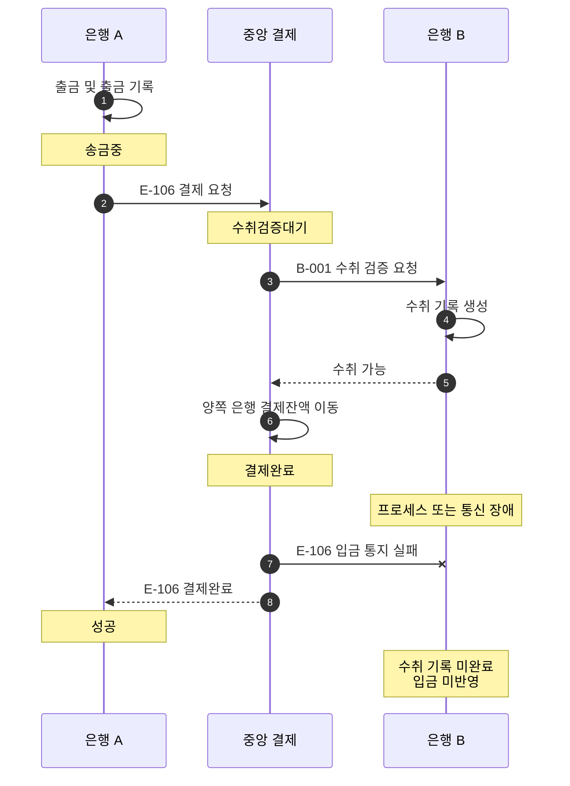

# S-008 — 결제완료 후 수취 입금 반영 지연

상태: 확정

## 목적

중앙 결제는 완료됐지만 입금 통지가 수취 은행에 도달하지 않아 고객 계좌에 입금하지 못한 중간 상태와 복구 책임을 확인한다.

## 사전 조건

- 고객 A의 은행 A 계좌 `A-001` 최초 잔액은 100,000원이다.
- 은행 B의 수취 계좌 `B-001` 최초 잔액은 100,000원이다.
- 송금액은 10,000원이고 외부 거래 ID는 `E-106`이다.
- 중앙 결제잔액은 최초에 은행 A와 은행 B가 각각 1,000,000원이다.

## 발생한 사건

1. 은행 A가 출금과 `송금중` 거래 생성을 완료하고 중앙 결제 시스템에 `E-106` 결제를 요청한다.
2. 중앙 결제 시스템이 `E-106`을 `수취검증대기`로 생성하고 은행 B에 수취 검증을 요청한다. 은행 B는 `B-001`의 존재를 확인하고 `E-106` 수취 기록을 만든 뒤 수취 가능을 응답한다.
3. 중앙 결제 시스템이 결제잔액을 이동하고 `E-106`을 `결제완료`로 확정한다.
4. 중앙 결제 시스템이 은행 B에 입금을 통지하지만 은행 B의 프로세스 또는 통신 장애로 통지가 처리되지 않는다.
5. 중앙 결제 시스템이 은행 A에 `결제완료`를 응답하고 은행 A는 로컬 송금을 `성공`으로 변경한다.

## 사건 흐름 다이어그램

## 장애 직후 확인되는 사실

### 송금 은행

- `A-001` 잔액은 90,000원이고 로컬 송금 상태는 `성공`이다.
- 출금 기록은 한 건이며 보상 기록은 없다.

### 중앙 결제 시스템

- `E-106` 상태는 `결제완료`다.
- 은행 A 결제잔액은 990,000원이고 은행 B 결제잔액은 1,010,000원이다.

### 수취 은행

- `B-001` 잔액은 아직 100,000원이고 `E-106` 입금 기록은 없다.
- `E-106` 수취 기록은 미완료 상태로 남아 있다.

## 최종 기대 결과

- 은행 B가 복구한 뒤 미완료 수취 기록 `E-106`의 결과를 중앙에 확인 조회하여 `결제완료`를 받으면, 한 로컬 DB 트랜잭션에서 `B-001` 잔액을 110,000원으로 변경하고 입금 기록을 한 건 생성하며 수취 기록을 완료한다.
- 중앙 결제 시스템이 같은 `E-106` 입금 통지를 다시 보내는 경우에도 결과는 같다.
- 수취 은행의 지연은 중앙 결제 결과나 은행 A의 성공 상태를 변경하지 않는다.

## 금지되는 결과

- 수취 입금 지연을 이유로 은행 A가 출금을 보상해서는 안 된다.
- 은행 B가 중앙 완료 근거 없이 임의로 입금하거나 같은 거래를 두 번 입금해서는 안 된다.

## 적용되는 불변식

- 중앙 결제완료는 수취 은행의 로컬 처리 지연으로 되돌아가지 않는다.
- 수취 은행은 완료된 중앙 결제를 고객 계좌에 정확히 한 번 반영해야 한다.
