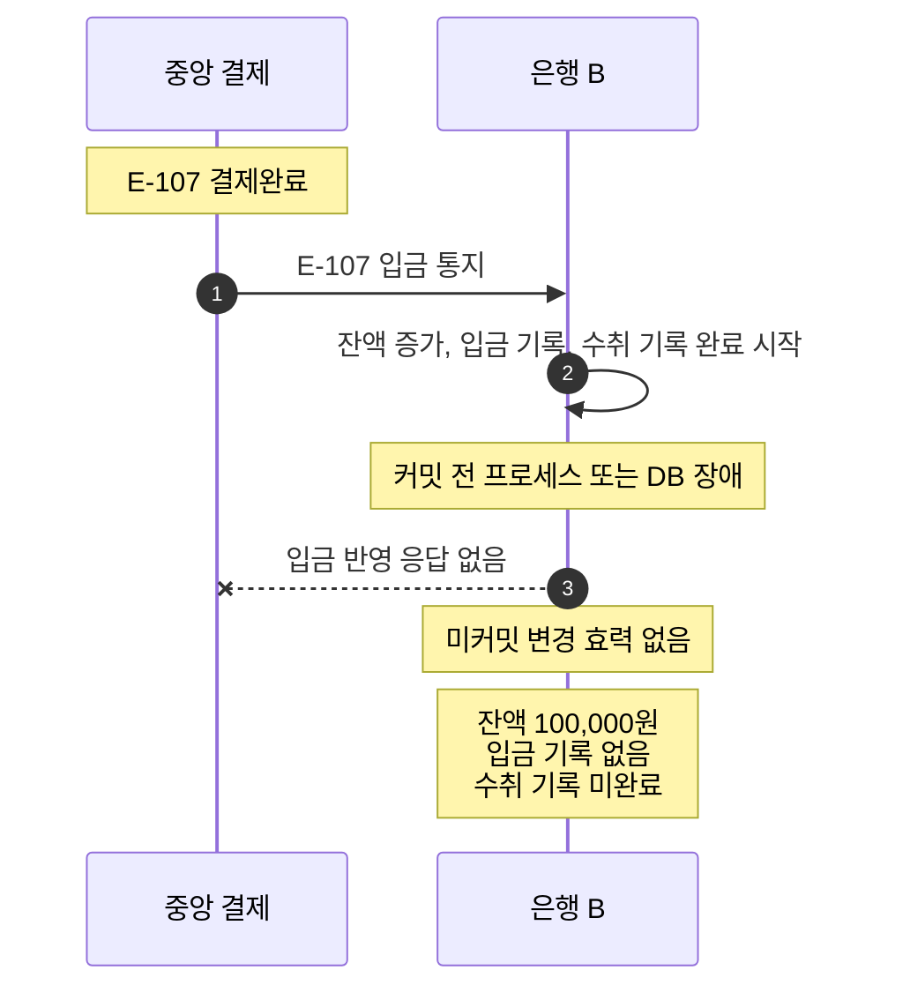

# S-009 — 수취 입금 커밋 전 장애

상태: 확정

## 목적

수취 은행이 입금 통지를 받아 시작한 로컬 트랜잭션이 커밋되기 전에 장애가 발생해도 잔액과 거래 기록이 부분적으로 남지 않는지 확인한다.

## 사전 조건

- 외부 거래 ID `E-107`, 금액 10,000원의 중앙 결제는 `결제완료`다.
- 은행 B에는 `E-107`의 미완료 수취 기록이 있다.
- 은행 B의 수취 계좌 `B-001` 잔액은 100,000원이다.
- 은행 B에 `E-107` 입금 기록은 없다.

## 발생한 사건

1. 중앙 결제 시스템이 은행 B에 `E-107` 입금을 통지한다.
2. 은행 B가 `B-001` 잔액 증가, 입금 기록 생성과 수취 기록 완료를 하나의 로컬 DB 트랜잭션에서 시작한다.
3. 로컬 DB 트랜잭션이 커밋되기 전에 은행 B의 프로세스 또는 DB 장애가 발생하고, 중앙 결제 시스템은 입금 반영 응답을 받지 못한다.

## 사건 흐름 다이어그램

## 장애 직후 확인되는 사실

### 송금 은행

- 로컬 송금 상태는 중앙 결제완료를 근거로 `성공`이거나, 응답을 받기 전이면 `송금중`이다. 어느 경우든 이 장애로 변하지 않는다.

### 중앙 결제 시스템

- `E-107` 상태는 `결제완료`로 유지된다.

### 수취 은행

- 로컬 트랜잭션은 커밋되지 않았다.
- `B-001` 잔액은 100,000원이고 `E-107` 입금 기록은 없으며 수취 기록은 미완료다.

## 최종 기대 결과

- 은행 B가 복구하여 미완료 수취 기록 `E-107`의 결과를 확인 조회하거나 중앙의 재통지를 받으면 잔액 증가와 입금 기록 생성을 다시 수행할 수 있다.
- 성공적으로 커밋된 뒤 `B-001` 잔액은 110,000원이고 입금 기록은 한 건이며 수취 기록은 완료 상태다.

## 금지되는 결과

- 잔액만 110,000원이 되고 입금 기록이 없거나, 입금 기록만 있고 잔액이 100,000원인 상태가 남아서는 안 된다.
- 로컬 커밋 실패가 중앙 결제완료를 거절로 바꾸어서는 안 된다.

## 적용되는 불변식

- 현재 잔액과 그 변동을 설명하는 거래 기록은 같은 로컬 DB 트랜잭션에서 함께 변경된다.
- 수취 은행의 로컬 장애는 완료된 중앙 결제 결과를 변경하지 않는다.
