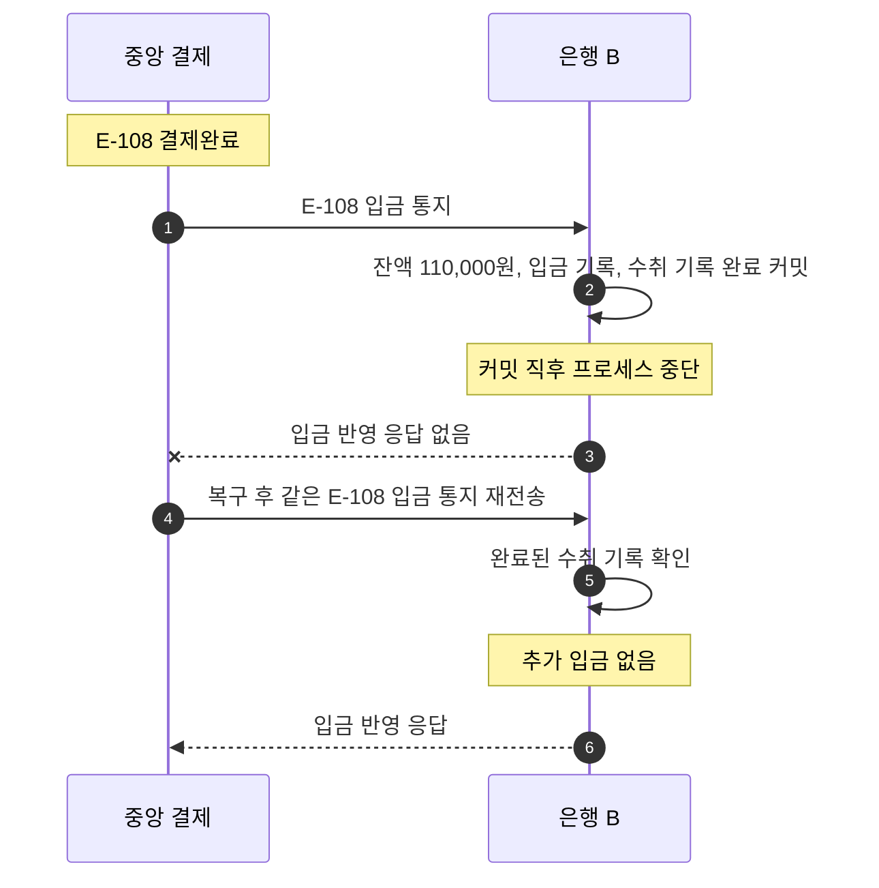

# S-010 — 수취 입금 커밋 후 장애

상태: 확정

## 목적

수취 입금은 커밋됐지만 직후 프로세스가 중단되어 응답이 유실되고, 같은 완료 거래가 다시 전달되어도 중복 입금되지 않는지 확인한다.

## 사전 조건

- 외부 거래 ID `E-108`, 금액 10,000원의 중앙 결제는 `결제완료`다.
- 은행 B에는 `E-108`의 미완료 수취 기록이 있다.
- 은행 B의 수취 계좌 `B-001` 잔액은 100,000원이다.
- 은행 B에 `E-108` 입금 기록은 없다.

## 발생한 사건

1. 중앙 결제 시스템이 은행 B에 `E-108` 입금을 통지한다.
2. 은행 B가 한 로컬 DB 트랜잭션에서 `B-001` 잔액을 110,000원으로 변경하고 `E-108` 입금 기록을 생성하며 수취 기록을 완료하여 커밋한다.
3. 커밋 직후 은행 B 프로세스가 중단되어 중앙 결제 시스템은 입금 반영 응답을 받지 못한다.
4. 중앙 결제 시스템이 같은 `E-108` 입금 통지를 복구된 은행 B에 다시 보낸다.

## 사건 흐름 다이어그램

## 장애 직후 확인되는 사실

### 중앙 결제 시스템

- `E-108` 상태는 `결제완료`로 유지된다.

### 수취 은행

- `B-001` 잔액은 110,000원이고 `E-108` 입금 기록은 이미 한 건 존재하며 수취 기록은 완료 상태다.
- 응답 유실로 같은 완료 거래가 다시 전달될 수 있다.

## 최종 기대 결과

- 은행 B는 외부 거래 ID `E-108`로 기존 입금 기록과 완료된 수취 기록을 확인하고 잔액을 다시 증가시키지 않는다.
- 최종 잔액은 110,000원이고 입금 기록은 한 건으로 유지된다.

## 금지되는 결과

- 같은 완료 거래의 재전달로 `B-001` 잔액이 120,000원이 되어서는 안 된다.
- 기존 거래 기록을 새 기록으로 덮어쓰거나 삭제해서는 안 된다.

## 적용되는 불변식

- 동일한 외부 거래 ID의 중앙 결제는 수취 계좌에 한 번만 반영된다.
- 로컬 반영 여부는 그 근거가 된 중앙 결제 거래까지 추적할 수 있어야 한다.
