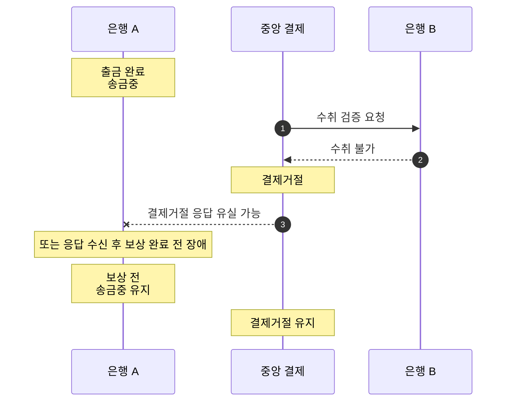

# S-011 — 결제거절 후 보상 지연

상태: 확정

## 목적

중앙 결제거절이 확정됐지만 송금 은행이 응답을 받지 못했거나 보상 전에 장애가 나서 아직 보상하지 못한 중간 상태와 최종 실패 조건을 확인한다.

## 사전 조건

- 고객 A의 은행 A 계좌 `A-001` 최초 잔액은 100,000원이다.
- `E-109`의 송금액은 10,000원이다.
- 은행 A에는 10,000원 출금 기록과 `송금중` 거래가 존재하고 `A-001` 잔액은 90,000원이다.
- 은행 B에 지정된 수취 계좌는 존재하지 않는다.
- 중앙 결제 시스템의 `E-109` 상태는 `수취검증대기`이고 은행 결제잔액 이동은 없다.

## 발생한 사건

1. 중앙 결제 시스템이 은행 B에 수취 검증을 요청하고 은행 B가 수취 불가를 응답한다.
2. 중앙 결제 시스템이 수취 불가 응답을 근거로 `E-109`를 `결제거절`로 확정한다.
3. 중앙 결제 시스템이 은행 A에 `결제거절`을 응답하지만, 은행 A가 응답을 받지 못했거나 응답을 받은 뒤 로컬 보상 트랜잭션을 완료하기 전에 장애가 발생한다.

## 사건 흐름 다이어그램

## 장애 직후 확인되는 사실

### 송금 은행

- `A-001` 잔액은 90,000원이고 출금 기록은 한 건이다.
- 보상 기록은 없으며 로컬 송금 상태는 아직 `송금중`이다.

### 중앙 결제 시스템

- `E-109` 상태는 `결제거절`이며 은행 결제잔액 이동은 없다.

### 수취 은행

- 존재하지 않는 지정 수취 계좌의 입금 기록은 생성되지 않으며, 은행 B의 다른 고객 계좌 잔액도 변하지 않는다.

## 최종 기대 결과

- 은행 A가 `송금중` 송금 `E-109`의 결과를 중앙에 확인 조회하여 `결제거절`을 받으면 한 로컬 DB 트랜잭션에서 10,000원 보상 기록과 잔액 반환을 처리한다. 보상 완료를 근거로 송금을 `실패`로 변경한다.
- 최종 `A-001` 잔액은 100,000원이며 출금과 보상 기록이 각각 한 건이다.

## 금지되는 결과

- 보상을 완료하기 전에 로컬 송금을 `실패`로 확정해서는 안 된다.
- 같은 거절 결과를 반복 확인하여 두 번 보상해서는 안 된다.
- 중앙 결제거절 거래가 수취 계좌에 입금되어서는 안 된다.

## 적용되는 불변식

- 중앙 결제거절이 실패와 보상의 권위 있는 근거다.
- `실패` 상태에는 원래 출금과 정확히 한 번의 보상 기록이 존재한다.
