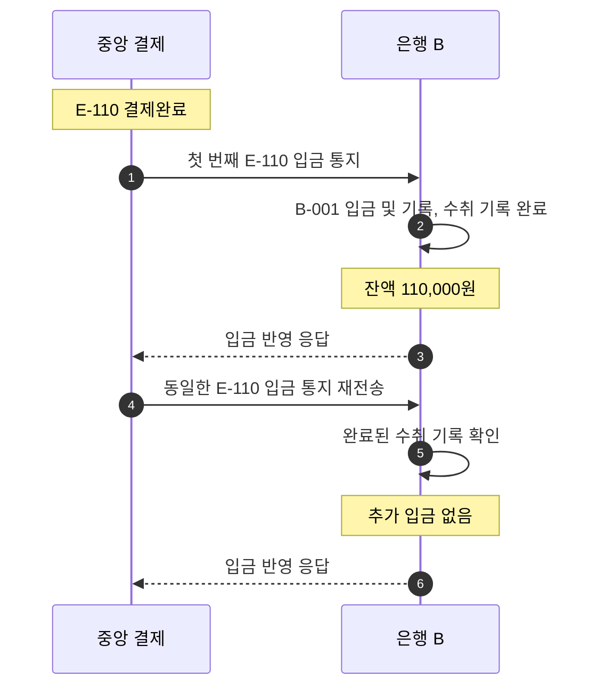

# S-012 — 입금 통지 중복 수신

상태: 확정

## 목적

수취 은행이 같은 완료 결제의 입금 통지나 확인 조회 결과를 여러 번 받아도 고객 계좌에 한 번만 반영되는지 확인한다.

## 사전 조건

- 중앙 결제 시스템의 `E-110`은 금액 10,000원의 `결제완료` 거래다.
- 은행 B에는 `E-110`의 미완료 수취 기록이 있다.
- 은행 B의 수취 계좌 `B-001` 최초 잔액은 100,000원이다.
- 은행 B에는 `E-110` 입금 기록이 없다.

## 발생한 사건

1. 은행 B가 중앙 결제 시스템으로부터 `E-110` 입금 통지를 받는다.
2. 은행 B가 `B-001` 잔액을 110,000원으로 변경하고 `E-110` 입금 기록을 생성하며 수취 기록을 완료한다.
3. 이후 중앙 결제 시스템의 재전송 또는 은행 B 자신의 확인 조회로 동일한 내용의 `E-110` 결제완료를 다시 받는다.

## 사건 흐름 다이어그램

## 확인되는 사실

### 중앙 결제 시스템

- `E-110`은 하나의 `결제완료` 거래이며 반복 전달로 상태나 결제잔액이 바뀌지 않는다.

### 수취 은행

- 첫 통지 이후 `E-110` 입금 기록이 한 건 존재하고 수취 기록은 완료 상태다.
- 두 번째 전달에서는 기존 로컬 반영을 확인하고 추가 입금을 실행하지 않는다.

## 최종 기대 결과

- `B-001` 최종 잔액은 110,000원이다.
- `E-110` 입금 기록은 정확히 한 건이다.

## 금지되는 결과

- 전달 횟수만큼 수취 잔액이 증가해서는 안 된다.
- 같은 외부 거래 ID에 두 개의 정상 입금 기록이 존재해서는 안 된다.

## 적용되는 불변식

- 재전송, 확인 조회와 여러 처리 시도에도 동일한 거래는 한 번만 반영된다.
- 동일한 외부 거래 ID와 수취 입금이라는 같은 반영 종류로 잔액을 두 번 변경해서는 안 된다.
