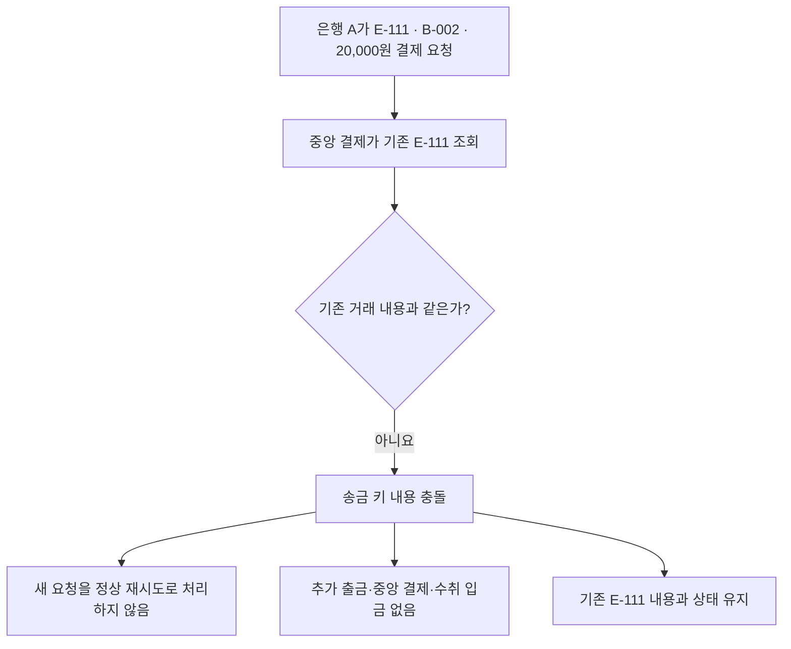

# S-013 — 송금 키 내용 충돌

상태: 확정

## 목적

송금 은행이 이미 사용한 `transfer_key`를 다른 거래 내용과 함께 중앙 결제 시스템에 다시 보냈을 때 정상 재처리로 간주하지 않는지 확인한다.

## 사전 조건

- 은행 A에는 `transfer_key` `E-111`, 송금 계좌 `A-001`, 수취 계좌 `B-001`, 금액 10,000원의 기존 송금이 존재한다.
- 기존 `E-111` 송금은 한 번 출금됐으며 중앙 결제 시스템에도 같은 내용의 거래가 존재한다.
- 고객 A가 사용할 `A-001`의 현재 잔액은 90,000원이다.

## 발생한 사건

1. 은행 A가 기존 거래와 같은 `transfer_key` `E-111`을 사용하면서 수취 계좌를 `B-002`, 금액을 20,000원으로 바꾼 결제 요청을 중앙 결제 시스템에 보낸다.
2. 중앙 결제 시스템이 기존 `E-111`의 거래 내용과 새 요청이 다르다는 사실을 확인한다.
3. 중앙 결제 시스템은 새 요청을 정상 재시도로 처리하지 않고 기존 `E-111`의 내용과 상태를 유지한다.

## 사건 흐름 다이어그램

## 확인되는 사실

### 송금 은행

- `A-001`에서 추가 출금하지 않고 새로운 송금이나 계좌 거래 기록을 생성하지 않는다.
- 기존 `E-111`의 내용과 상태는 변경하지 않는다.

### 중앙 결제 시스템

- 새 요청은 정상 재시도로 처리되지 않는다.
- 충돌한 요청으로 기존 `E-111`의 내용, 상태와 은행 결제잔액이 변경되지 않는다.

### 수취 은행

- `B-002`에는 충돌한 요청을 근거로 입금하지 않는다.

## 최종 기대 결과

- `E-111`은 최초에 등록된 송금 계좌, 수취 계좌와 금액을 유지한다.
- 중앙 결제 시스템은 충돌한 요청을 기존 거래의 정상 재시도로 받아들이지 않는다.

## 금지되는 결과

- 같은 `transfer_key`로 서로 다른 두 송금을 처리해서는 안 된다.
- 기존 거래 내용을 새 요청 내용으로 덮어써서는 안 된다.
- 충돌 요청으로 추가 출금, 중앙 결제 또는 수취 입금을 실행해서는 안 된다.

## 적용되는 불변식

- 동일한 `transfer_key`는 하나의 동일한 거래 내용만 식별한다.
- 동일한 ID의 내용 충돌을 정상 거래로 반영해서는 안 된다.
