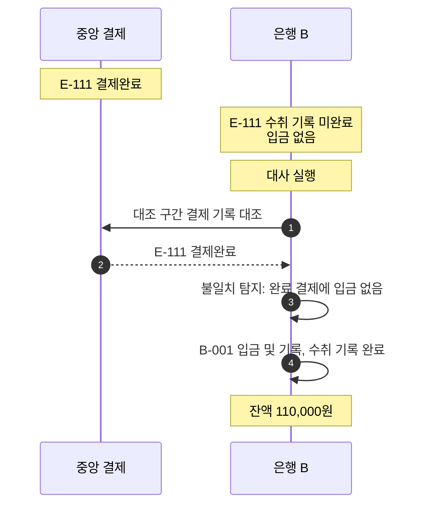

# S-014 — 대사에서 수취 입금 누락 탐지

상태: 초안

## 목적

정상 경로와 확인 조회가 모두 놓친 수취 입금 누락을 대사가 탐지하고, 수취 은행이 중앙 결제 기록을 근거로 로컬 상태를 수렴시키는지 확인한다.

## 사전 조건

- 외부 거래 ID `E-111`, 금액 10,000원의 중앙 결제는 `결제완료`로 확정되었다.
- 은행 A의 로컬 송금 `E-111`은 `성공`이다.
- 은행 B에는 `E-111`의 미완료 수취 기록이 있고 `B-001` 잔액은 100,000원, `E-111` 입금 기록은 없다.
- 은행 B의 입금 통지 처리와 확인 조회가 대사 실행 시점까지 반복 실패하여 입금이 반영되지 않았다.

## 발생한 사건

1. 은행 B가 대조 구간의 수취 기록과 중앙 결제 기록을 외부 거래 ID로 대조하는 대사를 실행한다.
2. 대사가 중앙에서는 `결제완료`이지만 은행 B에서는 수취 기록이 미완료이고 입금 기록이 없는 `E-111`을 불일치로 보고한다.
3. 은행 B가 `E-111`의 미완료 수취 기록을 근거로 한 로컬 DB 트랜잭션에서 `B-001` 잔액 증가, 입금 기록 생성과 수취 기록 완료를 수행한다.

## 사건 흐름 다이어그램

## 확인되는 사실

### 송금 은행

- 로컬 송금 `E-111`은 `성공`이며 대사로 변하지 않는다.

### 중앙 결제 시스템

- `E-111` 상태는 `결제완료`로 유지되며 대사는 이를 변경하지 않는다.

### 수취 은행

- 대사 전에는 수취 기록 미완료, 입금 기록 없음이다.
- 대사 후 `B-001` 잔액은 110,000원이고 `E-111` 입금 기록은 한 건, 수취 기록은 완료 상태다.

## 최종 기대 결과

- 대사가 `E-111`을 불일치로 탐지하고, 은행 B는 중앙 결제 기록을 근거로 입금을 정확히 한 번 반영한다.
- 대사 실행 전에 확인 조회가 먼저 입금을 반영한 경우 대사는 불일치를 보고하지 않는다.

## 금지되는 결과

- 대사가 중앙 결제 상태나 결제잔액을 변경해서는 안 된다.
- 대사와 확인 조회가 같은 `E-111`을 각각 입금하여 두 번 반영되어서는 안 된다.
- 대사가 수취 기록이 없는 결제를 임의로 입금해서는 안 된다.

## 적용되는 불변식

- 대사는 은행의 로컬 상태를 중앙 결제 기록에 맞춰 수렴시킬 뿐 중앙 결제 결과를 변경해서는 안 된다.
- 동일한 외부 거래 ID의 중앙 결제는 수취 계좌에 한 번만 반영된다.

## 미결 사항

- 대사 주기, 실행 시각과 대조 구간의 기준
- 대조 구간 경계에 걸치는 거래의 처리
- 불일치를 자동 복구할지 운영 확인 대상으로 남길지의 경계
