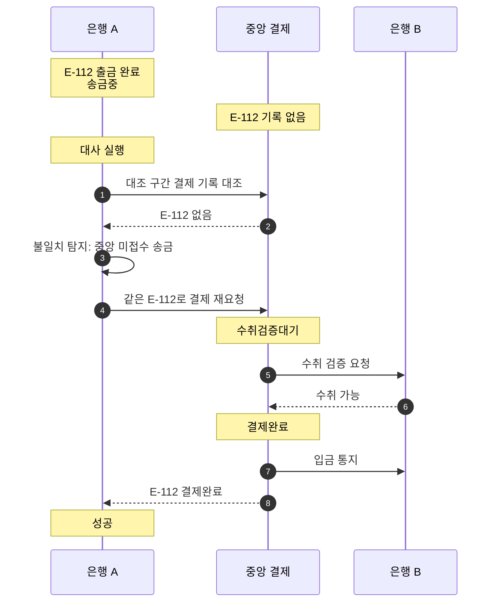

# S-015 — 대사에서 중앙 미접수 송금 탐지

상태: 초안

## 목적

송금 은행이 출금은 했지만 중앙 결제 요청이 도달하지 않아 중앙에 기록이 없는 `송금중` 송금을 대사가 탐지하고, 송금 은행이 같은 외부 거래 ID로 결제를 다시 요청하여 수렴시키는지 확인한다.

## 사전 조건

- 고객 A의 은행 A 계좌 `A-001` 최초 잔액은 100,000원이다.
- 은행 A에는 `E-112`, 금액 10,000원의 출금 기록과 `송금중` 거래가 있고 `A-001` 잔액은 90,000원이다.
- 은행 A의 `E-112` 결제 요청이 중앙에 도달하지 못했고, 확인 조회도 대사 실행 시점까지 중앙에서 `E-112`를 찾지 못했다.
- 중앙 결제 시스템에 `E-112` 기록은 없다.
- 은행 B에 수취 계좌 `B-001`이 존재한다.

## 발생한 사건

1. 은행 A가 대조 구간의 송금 기록과 중앙 결제 기록을 외부 거래 ID로 대조하는 대사를 실행한다.
2. 대사가 은행 A에는 `송금중`으로 존재하지만 중앙에는 기록이 없는 `E-112`를 불일치로 보고한다.
3. 은행 A가 같은 외부 거래 ID `E-112`와 같은 거래 내용으로 중앙에 결제를 다시 요청한다.
4. 중앙 결제 시스템이 `E-112`를 `수취검증대기`로 생성하고 정상 경로대로 수취 검증, 결제 확정, 입금 통지를 수행한 뒤 은행 A에 결과를 응답한다.
5. 은행 A가 응답 결과에 따라 로컬 송금을 `성공` 또는 `실패`로 확정한다.

## 사건 흐름 다이어그램

## 확인되는 사실

### 송금 은행

- 대사 전 `A-001` 잔액은 90,000원, 출금 기록 한 건, 송금 상태 `송금중`이다.
- 재요청 후에도 출금 기록은 한 건이며 추가 출금은 없다.

### 중앙 결제 시스템

- 대사 전에는 `E-112` 기록이 없다.
- 재요청 후 `E-112`는 하나의 결제로 존재하며 최종 상태로 확정된다.

### 수취 은행

- 재요청 전에는 `E-112` 관련 기록이 없다.

## 최종 기대 결과

- 대사가 `E-112`를 중앙 미접수 송금으로 탐지하고, 은행 A의 재요청으로 결제가 정상 경로를 거쳐 확정된다.
- 은행 A의 송금은 재요청 결과에 따라 `성공` 또는 `실패`로 수렴하며, 어느 경우든 출금은 한 번만 존재한다.

## 금지되는 결과

- 중앙에 기록이 없다는 이유만으로 은행 A가 `E-112`를 실패 처리하거나 출금을 보상해서는 안 된다.
- 재요청 시 다른 외부 거래 ID를 사용하여 같은 송금이 두 개의 결제로 생겨서는 안 된다.
- 재요청으로 `A-001`이 다시 출금되어서는 안 된다.

## 적용되는 불변식

- 하나의 송금에 대한 출금은 한 번만 실행되어야 한다.
- 동일한 결제 거래를 재전송하더라도 외부 거래 ID는 유지한다.
- 결과를 확인할 수 없다는 이유만으로 `송금중` 거래를 실패로 변경해서는 안 된다.

## 미결 사항

- 확인 조회가 "중앙에 없음"을 몇 번 확인한 뒤 재요청할지, 대사 시점까지 기다릴지의 기준
- 재요청 시 원래 요청과 다른 내용이 들어가는 경우의 충돌 처리는 S-013을 따른다
