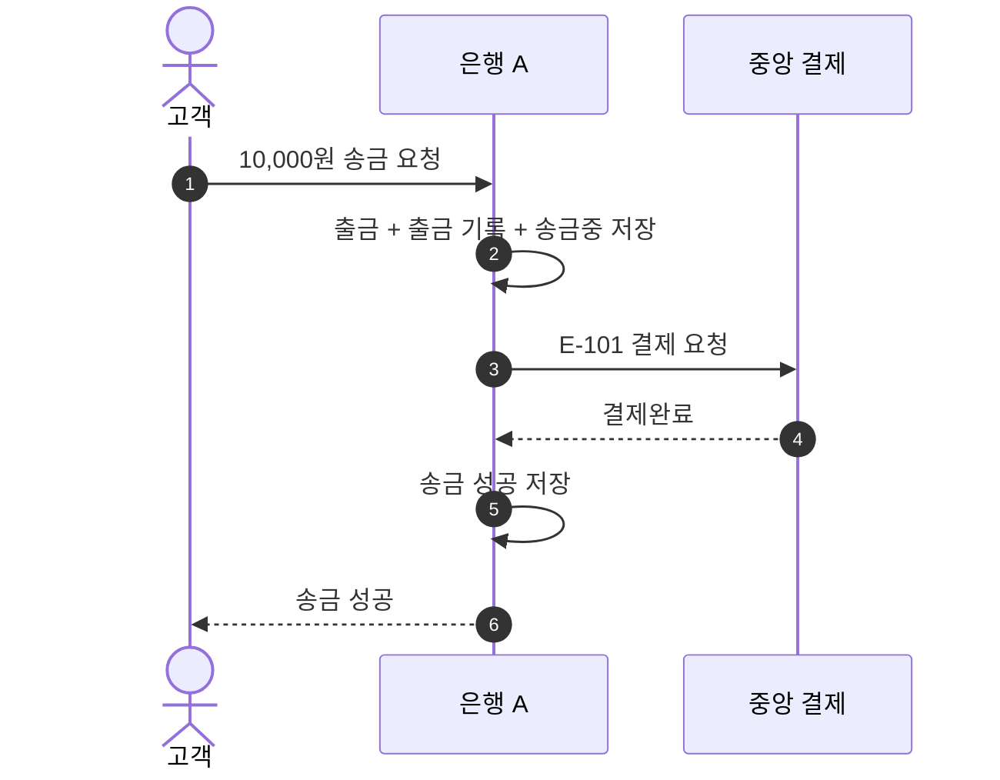

# S-101 — 송금 성공

상태: 확정

## 목적

중앙 결제 시스템이 `결제완료`를 정상 응답하면 송금 은행이 추가 출금 없이 송금을 `성공`으로 확정하는지 확인한다.

## 사전 조건

- 고객 A는 은행 A의 `A-001`을 소유하며 잔액은 100,000원이다.
- 송금액은 10,000원, 송금 키는 `E-101`이다.
- 중앙 결제의 확정 결과는 `결제완료`다.
- 요청과 응답은 정상적으로 전달된다.

## 사건 순서

1. 고객 A가 `A-001`에서 다른 은행 계좌로 10,000원 송금을 요청한다.
2. 은행 A가 송금액, 계좌 소유권과 잔액을 검증한다.
3. 은행 A가 하나의 로컬 DB 트랜잭션에서 출금, 출금 기록, `송금중` 송금을 저장한다.
4. 저장을 완료한 은행 A가 중앙 결제 시스템에 결제를 요청한다.
5. 중앙 결제 시스템이 `결제완료`를 응답한다.
6. 은행 A가 송금을 `성공`으로 저장하고 고객에게 성공을 응답한다.

## 사건 흐름

## 기대 결과

- `A-001` 잔액은 90,000원이다.
- 출금 기록은 한 건, 보상 기록은 없으며 송금은 `성공`이다.
- 중앙 결제에서 확인한 결과는 `결제완료`다.

## 금지되는 결과

- 중앙 결제완료를 확인하기 전에 송금을 성공으로 확정한다.
- 성공 응답을 반영하면서 고객 계좌를 다시 출금한다.
- 성공한 송금에 보상 기록을 생성한다.
