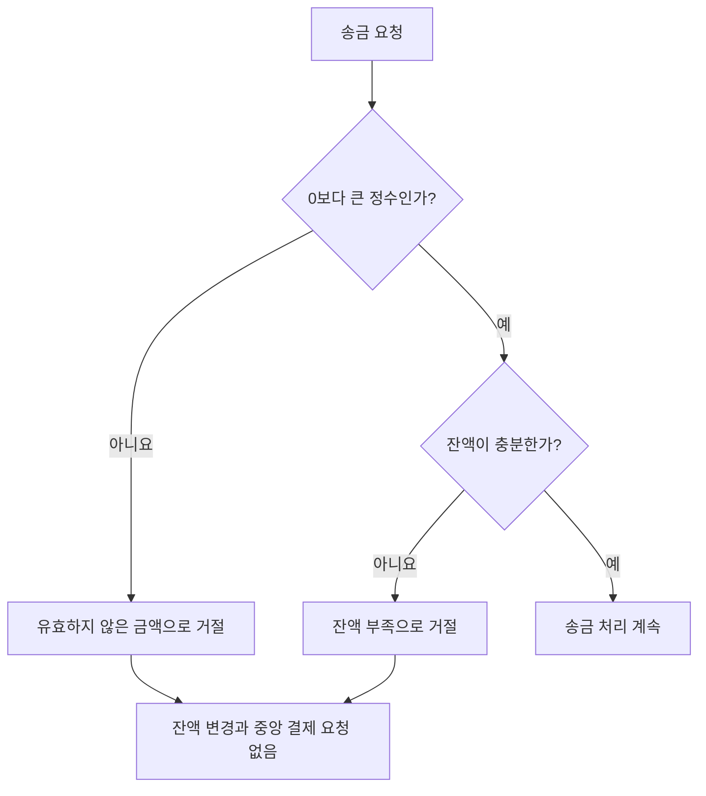

# S-102 — 송금 요청 거절

상태: 확정

## 목적

유효하지 않은 송금액 또는 고객 잔액 부족을 출금 전에 확인하고 송금 요청을 거절하는지 확인한다.

## 사전 조건

- 고객 A는 은행 A의 `A-001`을 소유하며 잔액은 100,000원이다.
- 유효하지 않은 금액 변형의 요청 금액은 0원이다. 음수와 비정수도 같은 금액 규칙의 거절 대상이다.
- 잔액 부족 변형의 요청 금액은 120,000원이다.

## 사건 순서

1. 고객 A가 `A-001`에서 다른 은행 계좌로 송금을 요청한다.
2. 요청 금액이 0보다 큰 정수가 아니면 은행 A가 유효하지 않은 금액으로 거절한다.
3. 금액은 유효하지만 계좌 잔액보다 크면 은행 A가 잔액 부족으로 거절한다.
4. 두 변형 모두 송금과 계좌 거래 기록을 저장하지 않고 중앙 결제를 요청하지 않는다.

## 사건 흐름

## 기대 결과

- 두 거절 변형 모두 `A-001` 잔액은 100,000원으로 유지된다.
- 송금, 출금과 보상 기록은 생성되지 않으며 중앙 결제를 요청하지 않는다.
- 고객은 유효하지 않은 금액 또는 잔액 부족에 맞는 거절 결과를 받는다.

## 금지되는 결과

- 거절할 요청을 먼저 출금한 뒤 보상한다.
- 사전 검증에서 거절한 요청을 `송금중` 또는 `실패`로 저장한다.
- 고객 잔액이 음수가 되거나 일부 금액만 출금된다.
