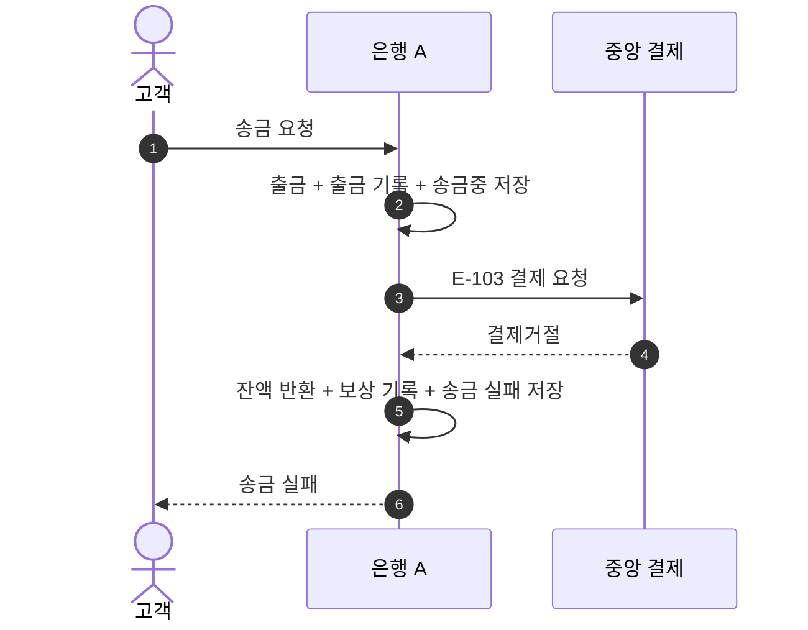

# S-103 — 수취 거절

상태: 확정

## 목적

수취 은행의 수취 불가 판단으로 중앙 결제가 `결제거절`을 정상 응답하면, 송금 은행이 출금을 한 번만 보상하고 송금을 `실패`로 확정하는지 확인한다.

## 사전 조건

- 고객 A의 은행 A 계좌 `A-001` 잔액은 100,000원이다.
- 송금액은 10,000원, 송금 키는 `E-103`이다.
- 중앙 결제의 확정 결과는 수취 불가에 따른 `결제거절`이다.
- 요청과 응답은 정상적으로 전달된다.

## 사건 순서

1. 은행 A가 하나의 로컬 DB 트랜잭션에서 출금, 출금 기록, `송금중` 송금을 저장한다.
2. 저장을 완료한 은행 A가 중앙 결제 시스템에 결제를 요청한다.
3. 중앙 결제 시스템이 `결제거절`을 응답한다.
4. 은행 A가 하나의 로컬 DB 트랜잭션에서 잔액 반환, 보상 기록, 송금 `실패`를 저장한다.
5. 은행 A가 고객에게 송금 실패를 응답한다.

## 사건 흐름

## 기대 결과

- `A-001` 잔액은 100,000원이다.
- 출금과 보상 기록은 각각 한 건이며 송금은 `실패`다.
- 중앙 결제에서 확인한 결과는 `결제거절`이다.

## 금지되는 결과

- 중앙 결제거절을 확인하기 전에 보상한다.
- 잔액 반환, 보상 기록과 송금 실패 중 일부만 저장한다.
- 같은 출금을 두 번 보상한다.
