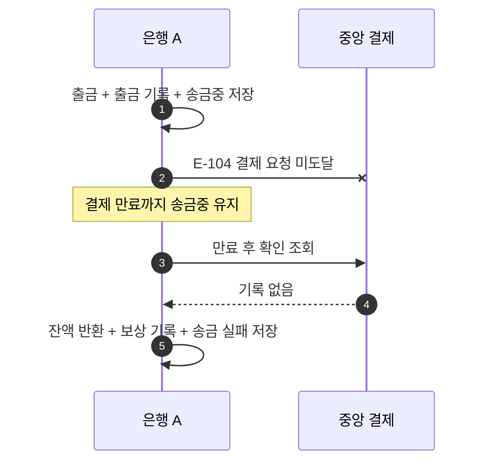

# S-104 — 결제 요청 미도달 후 복구

상태: 확정

## 목적

중앙에 도달하지 않은 결제 요청의 결과를 추측하지 않고, 결제 만료 후 중앙의 권위 있는 확인 조회에서 기록이 없음을 확인한 뒤 송금을 종료하는지 확인한다.

## 사전 조건

- 은행 A의 `A-001` 잔액은 100,000원이다.
- 송금액은 10,000원, 송금 키는 `E-104`다.
- 최초 결제 요청은 중앙 결제 시스템에 도달하지 않는다.

## 사건 순서

1. 은행 A가 출금, 출금 기록, `송금중` 송금을 함께 저장하고 중앙 결제를 요청한다.
2. 요청이 중앙 결제 시스템에 도달하지 않아 은행 A가 응답을 받지 못한다. 은행 A는 고객에게 송금이 `송금중`임을 응답한다.
3. 은행 A는 결과를 추측하지 않고 결제 만료 시간까지 `송금중`을 유지한다.
4. 결제 만료 시간이 지난 뒤 은행 A가 확인 조회한다.
5. 중앙 결제 시스템이 송금 키 `E-104`의 기록이 없음을 응답한다.
6. 은행 A가 만료 후의 권위 있는 `기록 없음`을 근거로 잔액 반환, 보상 기록, 송금 `실패`를 하나의 로컬 DB 트랜잭션에서 저장한다.

## 사건 흐름

## 기대 결과

- 은행 A의 잔액은 100,000원이며 출금과 보상 기록은 각각 한 건이다.
- 송금은 `실패`다.
- 중앙 결제 시스템에는 송금 키 `E-104`의 기록이 없다.

## 금지되는 결과

- 결제 만료 전에 받은 `기록 없음`만으로 보상한다.
- 중앙 결제에 연결하지 못한 결과를 `기록 없음`으로 간주한다.
- 만료 후 결과를 확정하기 위해 결제를 다시 요청한다.
- 같은 확인 조회를 반복하면서 두 번 보상한다.
