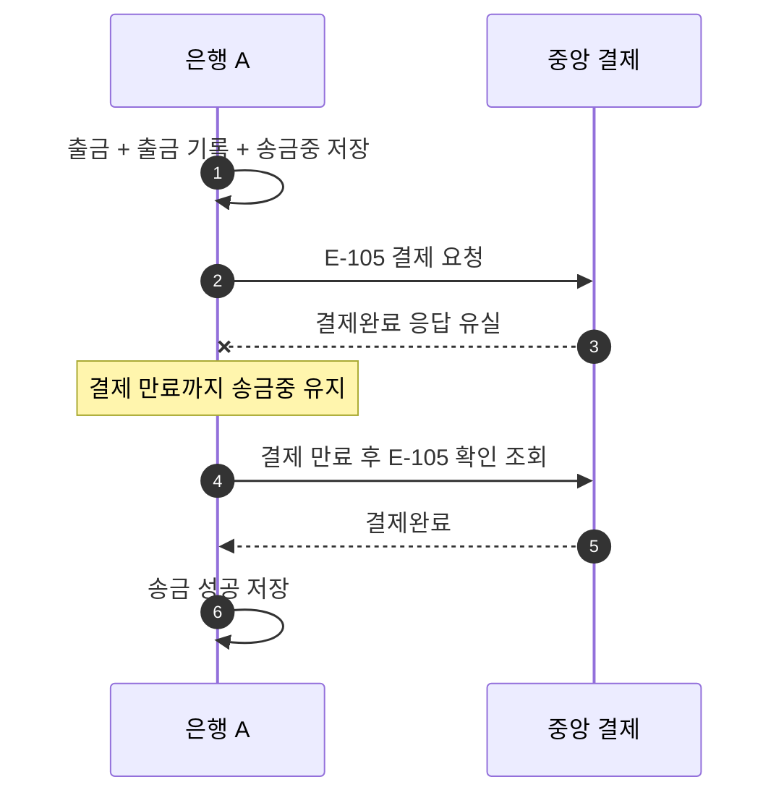

# S-105 — 결제완료 응답 유실 후 복구

상태: 확정

## 목적

중앙의 결제완료 응답이 유실되어도 송금 은행이 확인 조회로 성공을 반영하는지 확인한다.

## 사전 조건

- 은행 A의 `A-001` 잔액은 100,000원이다.
- 송금액은 10,000원, 송금 키는 `E-105`다.
- 중앙 결제의 확정 결과는 `결제완료`다.

## 사건 순서

1. 은행 A가 출금, 출금 기록, `송금중` 송금을 함께 저장하고 중앙 결제를 요청한다.
2. 중앙 결제 시스템이 은행 A에 보낸 `결제완료` 응답이 유실된다.
3. 은행 A는 결과를 추측하지 않고 결제 만료 시간까지 `송금중`을 유지한다.
4. 결제 만료 후 은행 A가 `E-105`를 확인 조회한다.
5. 중앙 결제 시스템이 `결제완료`를 응답한다. 은행 A가 추가 출금 없이 송금을 `성공`으로 저장한다.

## 사건 흐름

## 기대 결과

- 응답 유실 직후 `A-001` 잔액은 90,000원이고 출금 기록 한 건과 `송금중` 송금이 있다.
- 결제 만료 후 확인 조회를 마치면 송금은 `성공`이다.
- `A-001` 잔액은 90,000원이며 출금 기록은 한 건, 보상 기록은 없다.

## 금지되는 결과

- 응답 유실만으로 송금을 실패 처리하거나 출금을 보상한다.
- 성공 반영 과정에서 고객 잔액을 다시 차감하거나 출금 기록을 추가한다.
- 같은 송금 키의 재요청으로 결제를 중복 생성하거나 실행한다.
