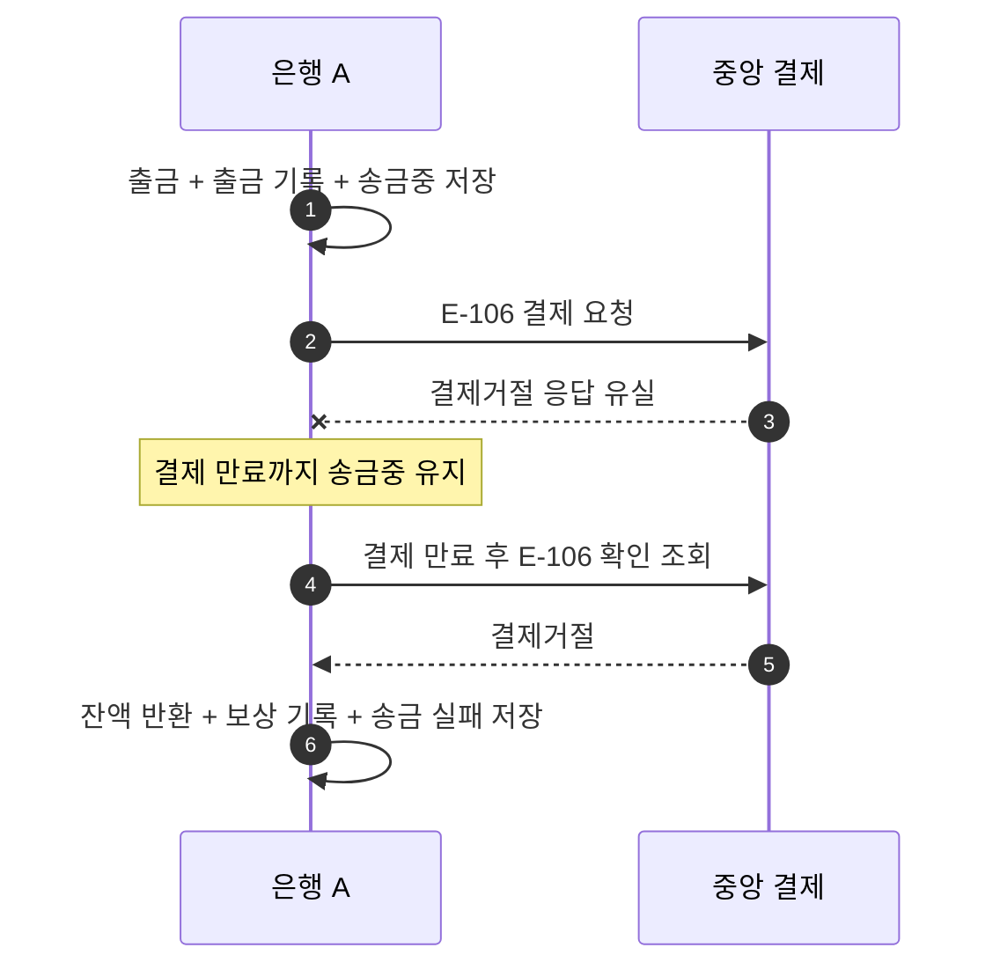

# S-106 — 결제거절 응답 유실 후 복구

상태: 확정

## 목적

결제거절 응답이 유실되면 송금 은행이 확인 조회로 거절을 확인하고 출금을 보상하는지 확인한다.

## 사전 조건

- 은행 A의 `A-001` 최초 잔액은 100,000원이다.
- 송금액은 10,000원, 송금 키는 `E-106`다.
- 중앙 결제의 확정 결과는 `결제거절`이다.

## 사건 순서

1. 은행 A가 출금, 출금 기록, `송금중` 송금을 함께 저장하고 중앙 결제를 요청한다.
2. 중앙 결제 시스템이 은행 A에 보낸 `결제거절` 응답이 유실된다.
3. 은행 A는 결과를 추측하지 않고 결제 만료 시간까지 `송금중`을 유지한다.
4. 결제 만료 후 은행 A가 송금 키 `E-106`을 확인 조회하여 `결제거절`을 받는다.
5. 은행 A가 하나의 로컬 DB 트랜잭션에서 잔액 반환, 보상 기록 생성, 송금 `실패`를 저장한다.

## 사건 흐름

## 기대 결과

- 응답 유실 직후 `A-001` 잔액은 90,000원이고 출금 기록 한 건, 보상 기록 없음, 송금 `송금중`이다.
- 보상 후 `A-001` 잔액은 100,000원이고 출금과 보상 기록은 각각 한 건, 송금은 `실패`다.
- 중앙 결제에서 확인한 결과는 `결제거절`이다.

## 금지되는 결과

- 중앙 결제거절을 확인하기 전에 보상한다.
- 잔액 반환, 보상 기록과 송금 실패 중 일부만 저장한다.
- 같은 거절 결과를 반복 확인하여 두 번 보상한다.
