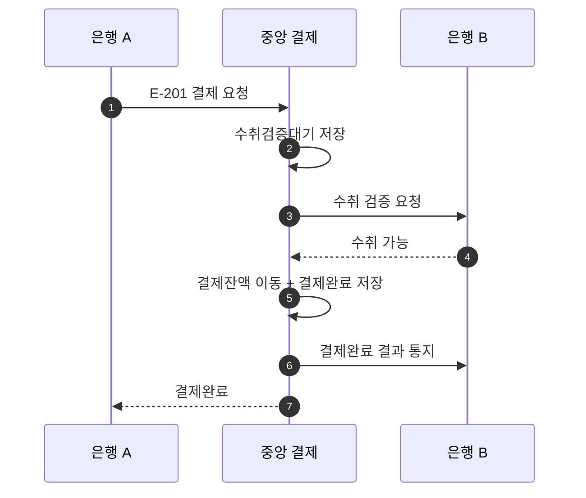

# S-201 — 중앙 결제 성공

상태: 확정

## 목적

수취 은행이 수취 가능을 응답하고 송금 은행의 결제잔액이 충분하면, 중앙 결제 시스템이 양쪽 은행의 결제잔액 이동과 결제완료를 하나의 트랜잭션으로 확정하는지 확인한다.

## 사전 조건

- 송금액은 10,000원, 송금 키는 `E-201`이다.
- 중앙 결제잔액은 은행 A와 은행 B가 각각 1,000,000원이다.
- 은행 B의 수취 계좌가 존재하며 수취 검증 요청과 응답은 제한 시간 안에 전달된다.

## 사건 순서

1. 은행 A가 중앙 결제 시스템에 `E-201` 결제를 요청한다.
2. 중앙 결제 시스템이 `수취검증대기` 결제를 저장하고 은행 B에 수취 검증을 한 번 요청한다.
3. 은행 B가 수취 가능을 응답한다.
4. 중앙 결제 시스템이 하나의 DB 트랜잭션에서 은행 A의 결제잔액을 10,000원 차감하고 은행 B의 결제잔액을 10,000원 증가시키며 결제를 `결제완료`로 변경한다.
5. 중앙 결제 시스템이 은행 B에 `결제완료` 결과를 통지한다.
6. 중앙 결제 시스템이 은행 A에 `결제완료`를 응답한다.

## 사건 흐름

## 기대 결과

- 중앙 결제는 `결제완료`다.
- 은행 A의 결제잔액은 990,000원, 은행 B의 결제잔액은 1,010,000원이다.
- 두 은행의 결제잔액 변경과 결제완료는 모두 저장되거나 모두 롤백된다.

## 금지되는 결과

- 수취 가능을 확인하기 전에 결제를 완료한다.
- 한쪽 은행의 결제잔액만 변경한다.
- 결제잔액 이동과 결제완료 중 일부만 저장한다.
- 같은 송금 키로 결제잔액을 두 번 이동한다.
