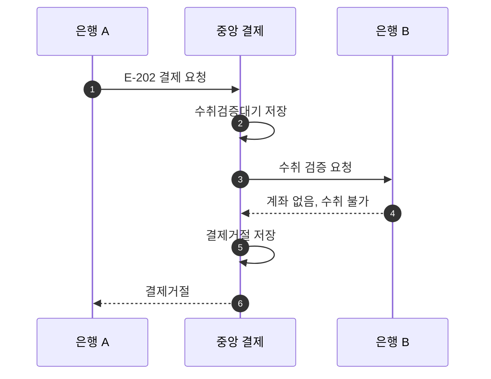

# S-202 — 수취 계좌 없음

상태: 확정

## 목적

수취 은행이 계좌가 없다고 응답하면 중앙 결제 시스템이 결제를 거절하고 결제잔액을 변경하지 않는지 확인한다.

## 사전 조건

- 은행 B에 수취 계좌 `B-404`는 없다.
- 송금액은 10,000원, 송금 키는 `E-202`이다.
- 두 은행의 중앙 결제잔액은 각각 1,000,000원이다.
- 요청과 응답은 정상적으로 전달된다.

## 사건 순서

1. 은행 A가 중앙 결제 시스템에 `E-202` 결제를 요청한다.
2. 중앙 결제 시스템이 `수취검증대기` 결제를 저장하고 은행 B에 수취 검증을 요청한다.
3. 은행 B가 `B-404`가 없음을 확인하고 수취 불가를 응답한다.
4. 중앙 결제 시스템이 `수취검증대기`인 결제를 `결제거절`로 변경하고 은행 A에 응답한다.

## 사건 흐름

## 기대 결과

- 중앙 결제는 `결제거절`이다.
- 두 은행의 결제잔액은 각각 1,000,000원으로 유지된다.
- 수취 기록은 생성되지 않으며 수취 은행에 결제 결과를 통지하지 않는다.

## 금지되는 결과

- 존재하지 않는 계좌에 대한 결제를 완료한다.
- 수취 불가 응답을 받은 뒤 송금 은행의 결제잔액을 확인한다.
- 결제잔액 일부만 변경한다.
