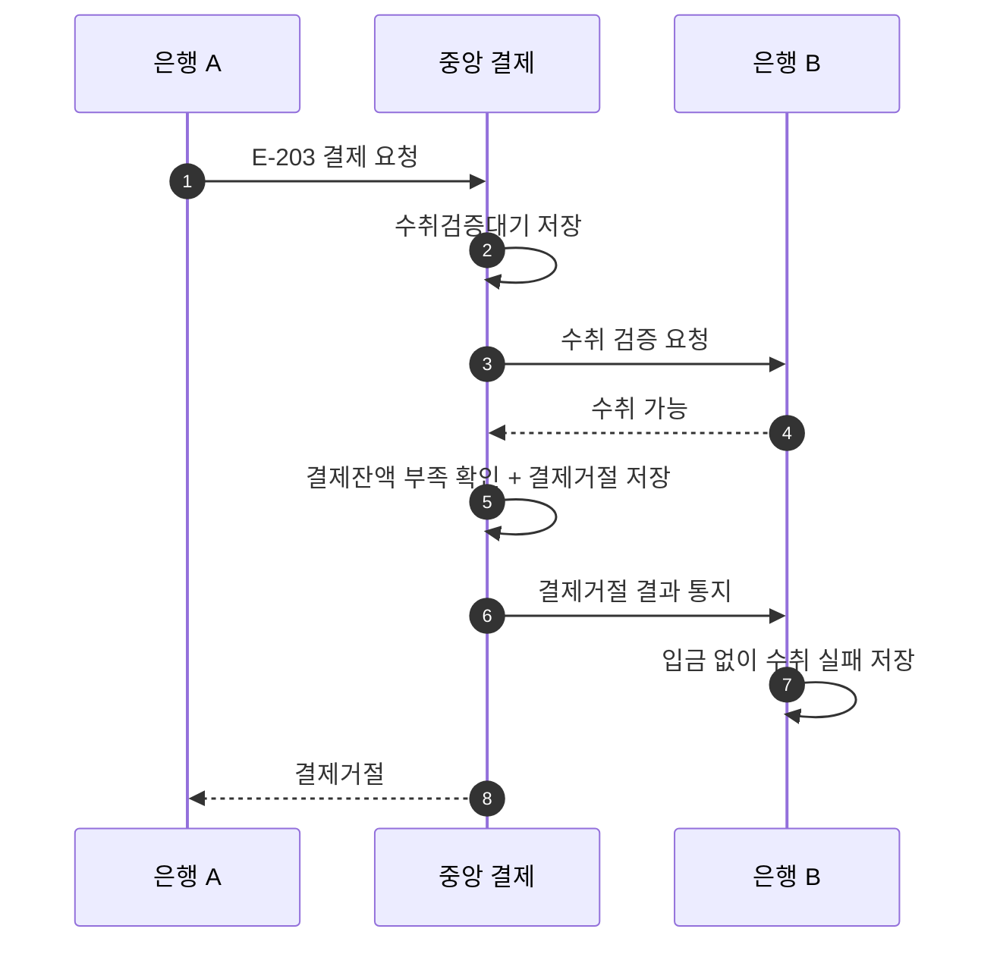

# S-203 — 송금 은행 결제잔액 부족

상태: 확정

## 목적

수취 가능을 확인했더라도 송금 은행의 중앙 결제잔액이 부족하면 중앙 결제 시스템이 결제를 거절하고 양쪽 은행의 결제잔액을 변경하지 않는지 확인한다.

## 사전 조건

- 송금액은 10,000원, 송금 키는 `E-203`이다.
- 중앙 결제잔액은 은행 A가 5,000원, 은행 B가 1,000,000원이다.
- 은행 B의 수취 계좌가 존재하며 수취 검증 결과는 수취 가능이다.

## 사건 순서

1. 은행 A가 중앙 결제 시스템에 `E-203` 결제를 요청한다.
2. 중앙 결제 시스템이 `수취검증대기` 결제를 저장하고 은행 B에 수취 검증을 요청한다.
3. 은행 B가 수취 가능을 응답한다.
4. 중앙 결제 시스템이 은행 A의 결제잔액 부족을 확인한다.
5. 중앙 결제 시스템이 결제잔액을 이동하지 않고 결제를 `결제거절`로 변경한다.
6. 중앙 결제 시스템이 은행 B에 `결제거절` 결과를 통지한다.
7. 은행 B가 고객 계좌에 입금하지 않고 수취를 `실패`로 변경한다.
8. 중앙 결제 시스템이 은행 A에 `결제거절`을 응답한다.

## 사건 흐름

## 기대 결과

- 중앙 결제는 `결제거절`이다.
- 은행 A의 결제잔액은 5,000원, 은행 B의 결제잔액은 1,000,000원으로 유지된다.
- 은행 B의 고객 계좌와 입금 기록은 변경되지 않으며 수취는 `실패`다.

## 금지되는 결과

- 은행 A의 결제잔액을 음수로 만든다.
- 은행 B의 결제잔액만 증가시킨다.
- 수취 가능 응답만으로 결제를 완료하거나 고객 계좌에 입금한다.
- 결제거절 결과를 확인한 뒤에도 수취 기록을 `수취대기`로 유지한다.
