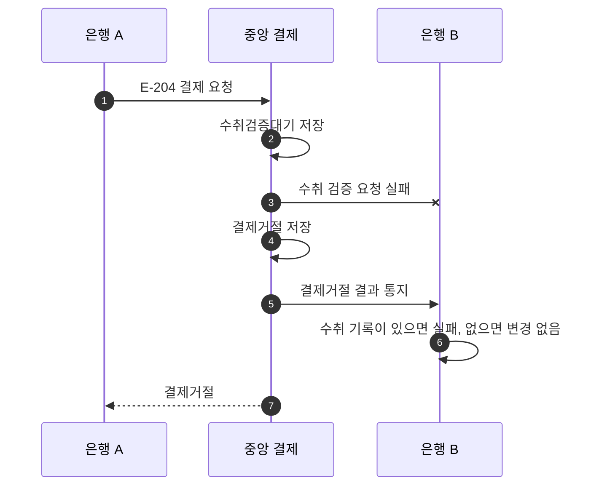

# S-204 — 수취 검증 요청 실패

상태: 확정

## 목적

수취 검증 요청이 타임아웃, 연결 실패, HTTP 오류 또는 해석할 수 없는 응답으로 완료되지 않으면 중앙 결제 시스템이 재요청하지 않고 결제를 거절한 뒤 결과를 통지하는지 확인한다.

## 사전 조건

- 송금액은 10,000원, 송금 키는 `E-204`이다.
- 두 은행의 중앙 결제잔액은 각각 1,000,000원이다.
- 중앙 결제 시스템은 수취 검증을 한 번만 요청한다.

## 사건 순서

1. 은행 A가 중앙 결제 시스템에 `E-204` 결제를 요청한다.
2. 중앙 결제 시스템이 `수취검증대기` 결제를 저장한다.
3. 중앙 결제 시스템이 은행 B에 수취 검증을 요청하지만 타임아웃, 연결 실패, HTTP 오류 또는 해석할 수 없는 응답으로 수취 가능 여부를 확인하지 못한다.
4. 중앙 결제 시스템이 제한 시간 안에 수취 가능을 확인하지 못했다는 정책에 따라 결제를 `결제거절`로 변경한다.
5. 중앙 결제 시스템이 은행 B에 `결제거절` 결과를 통지한다.
6. 은행 B에 수취 기록이 없으면 새 기록을 만들지 않는다. 수취 가능 응답만 전달되지 않아 수취 기록이 있다면 입금 없이 수취를 `실패`로 변경한다.
7. 중앙 결제 시스템이 은행 A에 `결제거절`을 응답한다.

## 사건 흐름

## 기대 결과

- 중앙 결제는 `결제거절`이다.
- 중앙 결제 시스템은 같은 수취 검증을 다시 요청하지 않는다.
- 두 은행의 결제잔액은 각각 1,000,000원으로 유지된다.
- 수취 기록이 없었다면 결과 통지만으로 새 수취 기록을 만들지 않는다.

## 금지되는 결과

- 기술적 실패를 수취 은행이 명시적으로 수취 불가를 응답한 것으로 기록한다.
- 검증 요청을 반복하여 중앙의 처리 자원과 수취 은행의 부하를 증가시킨다.
- 수취 가능 확인 없이 결제를 완료하거나 결제잔액을 이동한다.
- 결제거절 결과 통지만으로 존재하지 않던 수취 기록을 생성한다.
