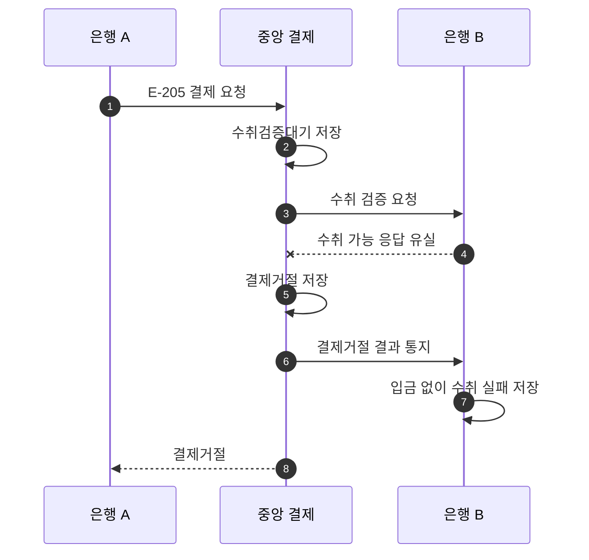

# S-205 — 수취 검증 응답 유실

상태: 확정

## 목적

수취 은행이 수취 가능을 응답했더라도 중앙 결제 시스템이 그 응답을 받지 못하면 결제를 거절하는지 확인한다.

## 사전 조건

- 은행 B에 수취 계좌 `B-001`이 존재한다.
- 송금액은 10,000원, 송금 키는 `E-205`이다.
- 두 은행의 중앙 결제잔액은 각각 1,000,000원이다.
- 은행 B가 보낸 수취 가능 응답은 중앙 결제 시스템에 도달하지 않는다.

## 사건 순서

1. 은행 A가 중앙 결제 시스템에 `E-205` 결제를 요청한다.
2. 중앙 결제 시스템이 `수취검증대기` 결제를 저장하고 은행 B에 수취 검증을 요청한다.
3. 은행 B가 수취 가능을 응답하지만 응답이 유실되어 중앙 결제 시스템에 도달하지 않는다.
4. 중앙 결제 시스템이 제한 시간 안에 수취 가능을 확인하지 못해 결제를 `결제거절`로 변경한다.
5. 중앙 결제 시스템이 은행 B에 `결제거절` 결과를 통지한다.
6. 은행 B가 입금 없이 수취를 `실패`로 변경한다.
7. 중앙 결제 시스템이 은행 A에 `결제거절`을 응답한다.

## 사건 흐름

## 기대 결과

- 중앙 결제는 `결제거절`이다.
- 두 은행의 결제잔액은 각각 1,000,000원으로 유지된다.
- 수취 검증은 재요청하지 않는다.
- 은행 B의 수취는 `실패`이며 고객 계좌와 입금 기록은 변경되지 않는다.

## 금지되는 결과

- 응답 유실 후 수취 검증을 재요청한다.
- 수취 가능 결과를 확인하지 못한 상태에서 결제잔액을 이동한다.
