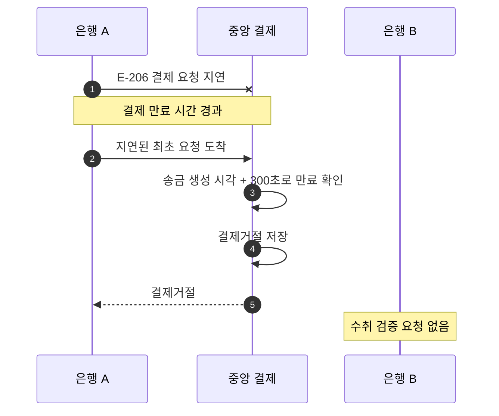

# S-206 — 만료된 지연 결제 요청

상태: 확정

## 목적

만료 전에 보낸 결제 요청이 네트워크에서 지연되어 만료 후 중앙에 처음 도착해도, 중앙 결제 시스템이 결제를 시작하지 않는지 확인한다.

## 사전 조건

- 송금액은 10,000원, 송금 키는 `E-206`이다.
- 요청에는 송금 은행의 송금 생성 시각인 `transferCreatedAt`이 포함되어 있다.
- 최초 결제 요청은 네트워크에서 지연되어 결제 만료 시간이 지난 뒤 중앙에 처음 도착한다.
- 두 은행의 중앙 결제잔액은 각각 1,000,000원이다.

## 사건 순서

1. 은행 A가 만료 전에 송금 키 `E-206`의 결제를 요청한다.
2. 결제 요청이 네트워크에서 지연되는 동안 결제 만료 시간이 지난다.
3. 지연된 최초 요청이 중앙 결제 시스템에 도착한다.
4. 중앙 결제 시스템이 요청에 포함된 송금 생성 시각부터 300초가 지났는지 확인해 만료 여부를 판단한다.
5. 중앙 결제 시스템이 수취 검증을 시작하지 않고 `결제거절`을 저장한 뒤 응답한다.

## 사건 흐름

## 기대 결과

- 중앙 결제 기록은 송금 키 `E-206`의 `결제거절` 한 건이다.
- 수취 검증은 시작되지 않는다.
- 두 은행의 결제잔액은 각각 1,000,000원으로 유지된다.

## 금지되는 결과

- 만료된 요청을 `수취검증대기`로 생성한다.
- 만료된 요청으로 수취 검증이나 결제잔액 이동을 시작한다.
- 요청이 실제로 도착한 시각을 송금 생성 시각으로 간주하여 유효한 요청으로 처리한다.
