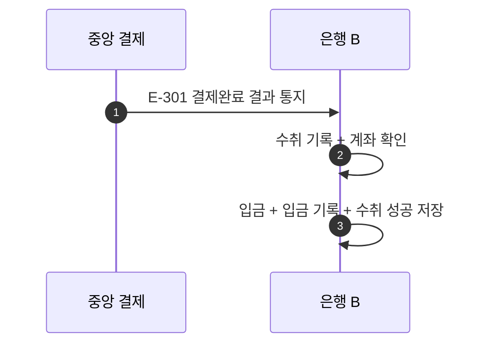

# S-301 — 결제완료 결과 통지

상태: 확정

## 목적

중앙 결제 시스템이 `결제완료` 결과를 통지하면, 수취 은행이 고객 계좌 입금, 입금 기록 생성과 수취 성공을 하나의 로컬 DB 트랜잭션으로 반영하는지 확인한다.

## 사전 조건

- 은행 B의 수취 계좌 `B-001` 잔액은 100,000원이다.
- 송금액은 10,000원, 송금 키는 `E-301`이다.
- 은행 B에는 수취 검증 과정에서 생성한 `수취대기` 수취 기록이 있다.
- 중앙 결제의 확정 결과는 `결제완료`다.

## 사건 순서

1. 중앙 결제 시스템이 은행 B에 송금 키 `E-301`의 `결제완료` 결과를 통지한다.
2. 은행 B가 수취 기록과 수취 계좌를 확인한다.
3. 은행 B가 하나의 로컬 DB 트랜잭션에서 고객 잔액을 10,000원 증가시키고 입금 기록을 생성하며 수취를 `성공`으로 변경한다.

## 사건 흐름

## 기대 결과

- `B-001` 잔액은 110,000원이다.
- 입금 기록은 한 건이며 수취는 `성공`이다.
- 잔액 증가, 입금 기록과 수취 성공은 모두 저장되거나 모두 롤백된다.

## 금지되는 결과

- 중앙 결제완료를 근거로 하지 않고 입금한다.
- 잔액, 입금 기록과 수취 상태 중 일부만 변경한다.
- 같은 송금 키로 고객 계좌에 두 번 입금한다.
