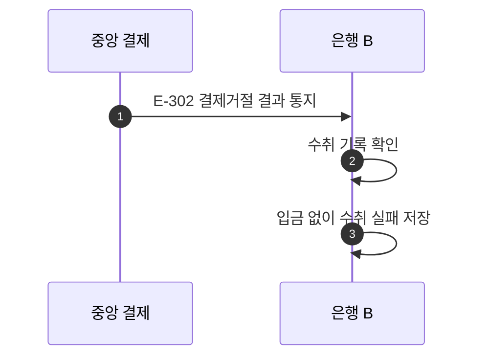

# S-302 — 결제거절 결과 통지

상태: 확정

## 목적

중앙 결제 시스템이 `결제거절` 결과를 통지하면, 수취 은행이 고객 계좌에 입금하지 않고 수취를 `실패`로 변경하는지 확인한다.

## 사전 조건

- 은행 B의 수취 계좌 `B-001` 잔액은 100,000원이다.
- 송금액은 10,000원, 송금 키는 `E-302`다.
- 은행 B에는 수취 검증 과정에서 생성한 `수취대기` 수취 기록이 있다.
- 중앙 결제의 확정 결과는 `결제거절`이다.

## 사건 순서

1. 중앙 결제 시스템이 은행 B에 송금 키 `E-302`의 `결제거절` 결과를 통지한다.
2. 은행 B가 수취 기록을 확인한다.
3. 은행 B가 고객 계좌와 입금 기록을 변경하지 않고 수취를 `실패`로 변경한다.

## 사건 흐름

## 기대 결과

- `B-001` 잔액은 100,000원으로 유지된다.
- 입금 기록은 없으며 수취는 `실패`다.
- 같은 결제거절 결과를 다시 통지해도 상태와 잔액은 추가로 변경되지 않는다.

## 금지되는 결과

- 결제거절 결과를 근거로 고객 계좌에 입금한다.
- 수취 기록을 `수취대기`로 유지한다.
- 같은 결과를 반복 통지하여 새로운 수취 기록을 생성한다.
