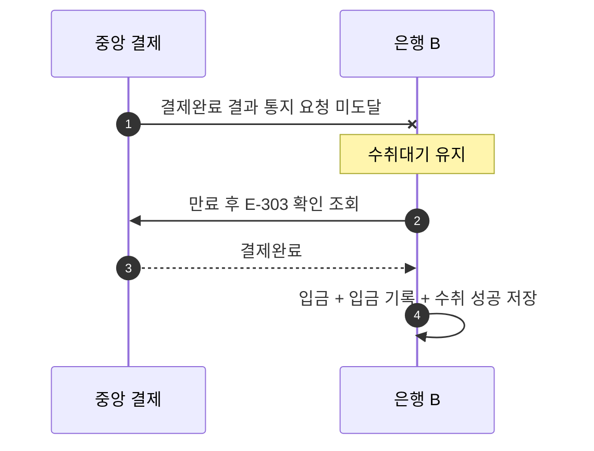

# S-303 — 결제완료 결과 통지 미도달

상태: 확정

## 목적

`결제완료` 결과 통지 요청이 수취 은행에 도달하지 않아도 수취 은행이 자신의 수취 기록을 확인 조회하여 입금을 완료하는지 확인한다.

## 사전 조건

- 은행 B의 `B-001` 잔액은 100,000원이다.
- 송금액은 10,000원, 송금 키는 `E-303`이다.
- 은행 B에는 `수취대기` 수취 기록이 있다.
- 중앙 결제의 확정 결과는 `결제완료`다.

## 사건 순서

1. 중앙 결제 시스템이 `결제완료` 결과를 통지하지만 요청이 통신 장애로 은행 B에 도달하지 않는다.
2. 은행 B는 결과를 추측하지 않고 수취를 `수취대기`로 유지한다.
3. 결제 만료 시간이 지나고 통신이 복구되면 은행 B가 `수취대기` 기록의 송금 키 `E-303`으로 확인 조회한다.
4. 중앙 결제 시스템이 `결제완료`를 응답한다.
5. 은행 B가 하나의 로컬 DB 트랜잭션에서 입금, 입금 기록, 수취 `성공`을 저장한다.

## 사건 흐름

## 기대 결과

- 확인 조회 전: 수취는 `수취대기`다. `B-001` 잔액은 100,000원이며 입금 기록은 없다.
- 확인 조회 후: `B-001` 잔액은 110,000원이며 입금 기록은 한 건, 수취는 `성공`이다.
- 중앙 결제에서 확인한 결과는 `결제완료`다.

## 금지되는 결과

- 중앙 결제완료를 확인하지 않고 입금한다.
- 같은 결제를 수취 계좌에 두 번 반영한다.
