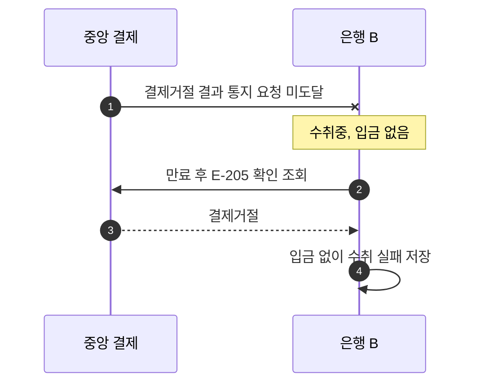

# S-304 — 결제거절 결과 통지 미도달

상태: 확정

## 목적

수취 가능 응답이 유실되어 중앙 결제가 거절된 뒤 `결제거절` 결과 통지 요청도 도달하지 않은 경우, 수취 은행이 확인 조회로 거절을 확인하고 입금 없이 수취를 종료하는지 확인한다.

## 사전 조건

- 은행 B에 수취 계좌 `B-001`이 존재하며 잔액은 100,000원이다.
- 송금액은 10,000원, 송금 키는 `E-205`이다.
- 은행 B에는 송금 생성 시각이 저장된 `수취중` 수취 기록이 있고 입금 기록은 없다.
- 수취 가능 응답은 유실됐으며 중앙 결제의 확정 결과는 `결제거절`이다.
- 중앙 결제의 `결제거절` 결과 통지 요청은 은행 B에 도달하지 않는다.

## 사건 순서

1. 중앙 결제 시스템이 은행 B에 `결제거절` 결과를 통지하지만 요청이 도달하지 않는다.
2. 은행 B는 결과를 추측하지 않고 수취를 `수취중`으로 유지한다.
3. 송금 생성 시각부터 300초가 지나면 은행 B의 복구 작업이 `수취중`인 송금 키 `E-205`를 확인 조회한다.
4. 중앙 결제 시스템이 `결제거절`을 응답한다.
5. 은행 B가 입금 없이 수취를 `실패`로 저장한다.

## 사건 흐름

## 기대 결과

- `B-001` 잔액은 100,000원으로 유지된다.
- 입금 기록은 없으며 수취는 `실패`다.
- 중앙 결제에서 확인한 결과는 `결제거절`이다.

## 금지되는 결과

- 수취 가능을 판단했다는 이유만으로 고객 계좌에 입금한다.
- 중앙 결제거절을 확인한 뒤에도 수취를 `수취중`으로 유지한다.
- 실패 처리 과정에서 고객 잔액이나 입금 기록을 변경한다.
