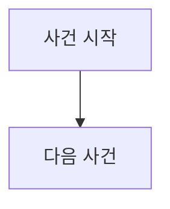

# S-XXX — 시나리오 이름

상태: 초안

## 목적

이 시나리오에서 확인하려는 하나의 정상 흐름, 거절 또는 장애를 작성한다.

## 사전 조건

- 송금 고객과 소유 관계:
- 송금 계좌와 초기 잔액:
- 수취 은행과 수취 계좌:
- 수취 계좌 초기 잔액:
- 송금액:
- 외부 거래 ID:
- 송금·수취 은행의 중앙 결제잔액:
- 기존 거래 기록:

## 발생한 사건

1. 사건을 시간순으로 작성한다.
2. 상태 전이와 장애가 발생한 정확한 지점을 명시한다.
3. 아직 합의하지 않은 재시도 횟수, polling 주기와 구현 방법은 쓰지 않는다.

## 사건 흐름 다이어그램

`발생한 사건`을 순서대로 옮긴 Mermaid 다이어그램을 작성한다. 다이어그램에는 본문에 없는 상태, 분기나 복구 방법을 추가하지 않는다.

## 장애 직후 확인되는 사실

### 송금 은행

- 고객 계좌 잔액, 계좌 거래 기록과 로컬 송금 상태를 작성한다.

### 중앙 결제 시스템

- 중앙 결제 거래 상태와 양쪽 은행 결제잔액을 작성한다.

### 수취 은행

- 수취 계좌 잔액, 계좌 거래 기록과 로컬 반영 여부를 작성한다.

## 최종 기대 결과

- 반복 조회와 멱등한 로컬 반영 후 각 시스템이 수렴해야 하는 상태를 작성한다.
- 고객이 계좌와 거래 내역에서 확인하는 결과를 작성한다.

## 금지되는 결과

- 이중 출금·입금, 근거 없는 보상과 거래 기록 없는 잔액 변경 등 절대 발생해서는 안 되는 결과를 작성한다.

## 적용되는 불변식

- 이 사례에서 검증할 합의된 불변식을 작성한다.
